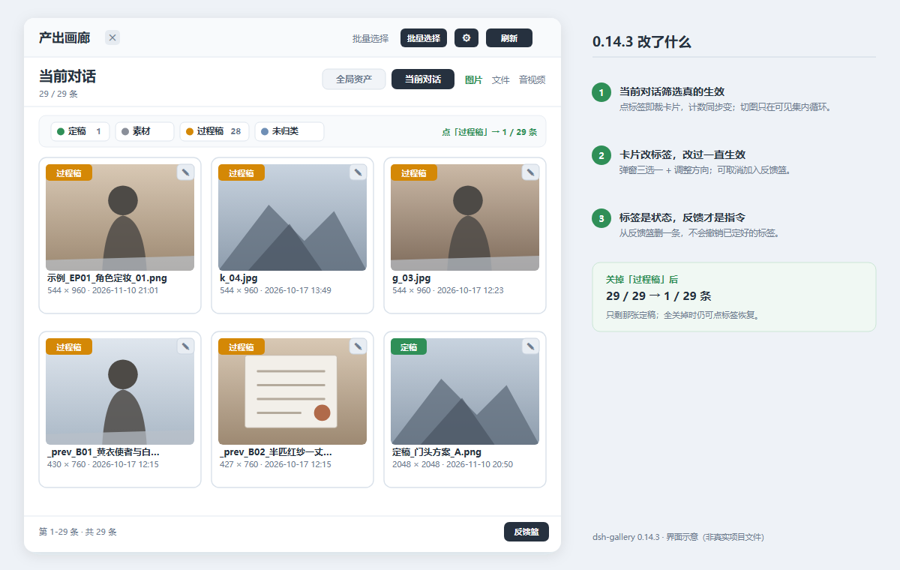
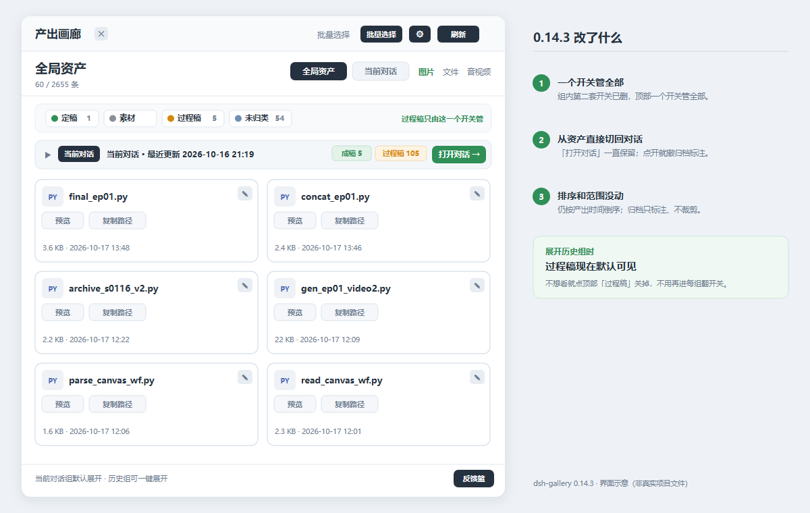
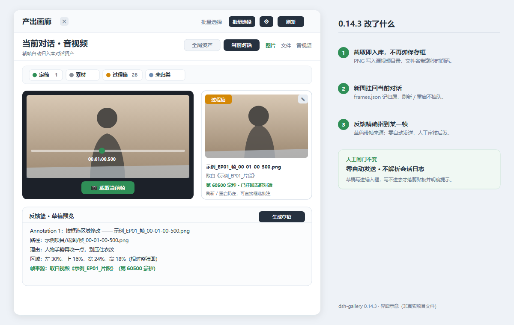
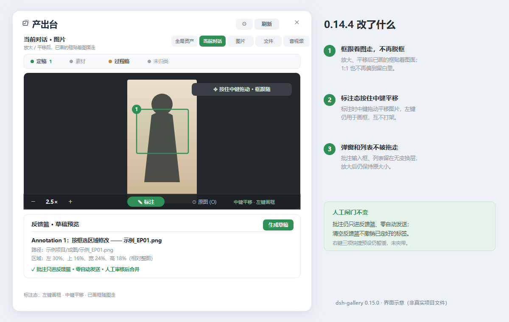
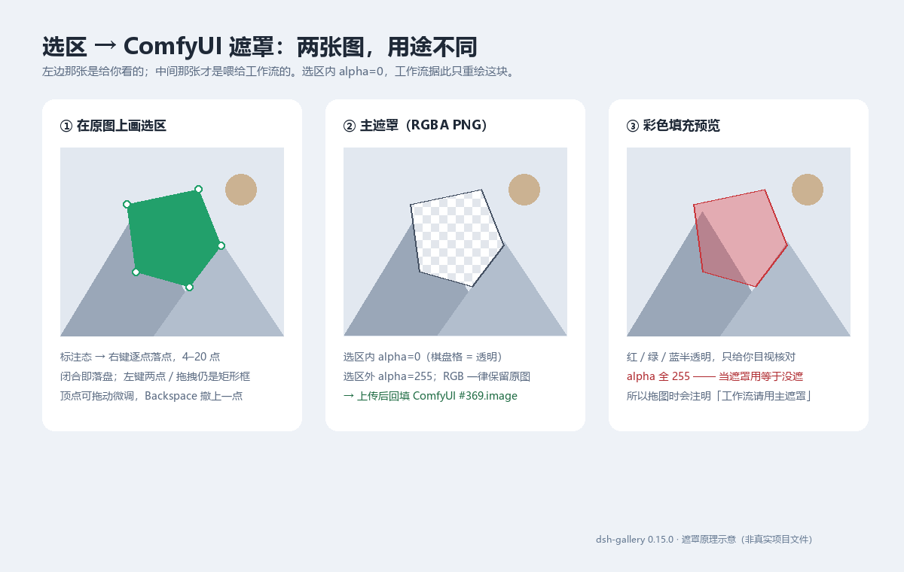

# 产出台 · DeepSeek Harness (DSH) 插件

> **核心问题：Agent 干活的过程是黑箱。**
> DSH 默认**只在任务结束时**才列出产出的文件名和路径 —— 中间生成的东西你看不见，
> 出了偏差只能等它跑完再返工。
>
> 这个插件把产出目录变成右侧栏里的**实时画廊**：图片生成就可见、文件点开就预览、
> 视频音频能在面板里直接播放并拖进度条，
> **让你在任务进行中就能看到产出、当场校验，而不是结束后才发现做错了。**
>
> 📌 **当前版本 `0.15.0`（2026-11-12 发布）**：实时看见、当场校验、就地处置已可用，并且能给 ComfyUI 工作流画遮罩了。
> 判断只保留两层——原生产出标签（素材 / 过程稿 / 定稿 / 未归类，**可手动改、改过就一直生效**）与反馈篮（人工审核合并发送）。
> **表态定性层与「自动递便条」决策包已下线**：前者多余，后者会绕过反馈栏刻意设的人工闸门。详见 [判断分两层](#判断分两层标签--反馈v0142)。
> 视频「📷 截取当前帧」**自动存进当前对话资产**，文件名写清取自哪一帧，可直接框选批注进反馈篮；
> **左键画矩形框、右键逐点闭合成实心多边形**，导出的就是 ComfyUI 直接能吃的 RGBA 遮罩（另出一张红 / 绿 / 蓝半透明填充预览供目视核对）。
> 图**拖进对话框会自动带上文件名与绝对路径**（有遮罩的还带主遮罩名），Agent 不必扫目录找图。
> 图上**批注框跟随缩放平移**（放大后圈选仍落在原图同一处）；**标注态按住鼠标中键拖动**即可平移图片、已画框跟着走。

[](#)
[](LICENSE)
[](#技术说明给想改代码的人)
[](#兼容性)
[](#)

**关键词**：DeepSeek Harness 插件 · DSH plugin · 产出台 · output gallery · 图片画廊 · image gallery · 文件预览 · file preview · **音视频画廊 · media gallery · 视频预览 · video preview** · 侧边栏面板 · sidebar panel · Agent 产出管理 · output artifacts · **产出标签 · asset label · 手动改标签 · manual label · 反馈篮 · feedback basket · 批注 · annotation · region selection · 截帧 · frame capture · 批注跟随 · annotation follow · 中键平移 · middle mouse pan · 批量处置 · batch actions**

### 界面一览

> 以下为界面示意，文件名与项目名均为通用示例，不展示真实项目内容。

**① 当前对话**：写盘即可见；顶部四个标签点一下就筛，卡片右上角「✎」改标签（改过一直生效）。



**② 全局资产**：按会话分组，当前对话置顶；从资产直接「打开对话」切回去。



**③ 截帧入库**：视频「截取当前帧」自动存进当前对话，文件名带毫秒时间码，可框选批注并带帧来源进反馈篮。



**④ 标注跟随**：放大 / 平移后已画的框贴着图面走、不脱框；标注态按住鼠标中键拖动平移，左键仍用于画框。



**⑤ 选区 → 遮罩**（原理示意）：左边是给你看的选区，中间那张 RGBA 主遮罩才是喂给工作流的 —— 选区内 `alpha=0`、外部保留原图；右边的彩色填充只用于目视核对，不能当遮罩用。



---

## 它解决什么问题

### 痛点：任务跑完你才知道结果

让 Agent 出 30 张图、改一份报告、跑一段脚本 —— 它埋头干几分钟甚至几十分钟，
你**看不到中间产物**。等到最后它念一串路径，你才发现：

- 第 3 张图的风格就跑偏了，30 张全废
- 报告第 2 段引用了错的资料，整篇要重写
- 脚本输出了 50 个中间文件，你不知道哪个是最终版

**返工成本是「一次性验证」的好几倍。**

### 解法：把产出目录变成实时画廊

插件**直接盯磁盘上的产出目录**（Agent 真正写文件的地方），做成右侧栏画廊：

| 效果 | 说明 |
|---|---|
| **图生成就可见** | 每 5 秒自动刷新，缩略图实时滚动，不顺眼当场喊停 |
| **文件点一下就开** | 调 DSH **原生侧栏预览**（Markdown 渲染、代码高亮都是 DSH 自己的） |
| **只看本对话的** | 多个对话混在一起时，按「当前对话」筛，一眼分清谁做的 |
| **过程产物也算** | 脚本跑出来的中间图、Agent 打开看过的图，都算本对话产出 —— **过程不黑箱** |

### 和市面上的「对话图片查看器」不一样在哪

| | 常见的对话图片灯箱 | 这个插件 |
|---|---|---|
| **看哪里** | 对话里的图片附件 | **磁盘上的产出目录**（Agent 真正写文件的地方） |
| **能看什么** | 只有图片 | 图片 + **49 种文档/代码/数据文件** |
| **怎么打开文件** | 无 | **调 DSH 原生侧栏预览** |
| **多个对话混在一起** | 不区分 | **可按「本对话产出」筛** |
| **过程产物** | 看不到 | **脚本生成的中间图也能看到** |

> **一句话安装**：解压后在该目录执行 `node install.mjs`，然后重启 DSH。
> 详细步骤见[安装](#安装)，常见问题见[已知限制](#已知限制)。

---

## 功能

### 图片画廊

| 能力 | 说明 |
|---|---|
| **自动刷新** | 每 5 秒轮询，查看大图时自动暂停，不打断 |
| **缩略图** | 客户端 canvas 压缩到 200px（不是原图直塞），并发闸门 4，进入视口才加载 |
| **放大查看** | 滚轮缩放（最大 8×，**以光标位置为中心**）、左键或中键拖动平移；标注态左键留给画框，改按**中键**平移 |
| **看原图** | 缩略图右键「查看原图」直接按原图像素打开；查看器内切换原图/预览（底部按钮、右键、`O` 键），**切换时保留缩放与位置**；按需加载并显示进度，不预加载 |
| **音视频画廊** | 视频/音频独立第三栏；视频首帧缩略图（进入视口才抽帧）；点击面板内播放（原生 `<video>`/`<audio>`，支持拖动进度条）；体积上限 200 MB 可调 |
| **右侧控制列** | 放大后出现 `▲` / `▼` 按钮 + 轨道 + 滑块，**没有鼠标也能操作** |
| **键盘操作** | `↑↓` 平移、`←→` 切图、`+/-` 缩放、`0` 复位、`O` 切原图、`Esc` 退出 |
| **拖到对话**（v0.15.0） | 拖卡片、或点查看器工具条上的「⇥ 拖到对话」，输入框自动填入 `产出台·<文件名> ｜ 路径=<绝对路径> ｜ 主遮罩=<对应遮罩>`。**只填不发**；宿主不接时退化为复制到剪贴板并提示 |
| **退出回位** | 单击退出，回到原来那张缩略图的**精确位置**，不是列表顶部 |

### 框选批注 → ComfyUI 遮罩（v0.15.0）

给「局部重绘 / 移除」这类工作流补上人画的遮罩，不必切到 ComfyUI 画布。

| 步骤 | 行为 |
|---|---|
| ① 进入标注 | 图片查看器里点「标注」。**左键点两下或拖一下 = 矩形框（和以前一样）**；**右键逐点落点、闭合 = 实心多边形选区**（4–20 点，顶点还能左键拖动微调，`Backspace` 撤上一点、`Escape` 清空、`Enter` 闭合） |
| ② 导出 | 批注列表里这条框右侧的「**导出遮罩**」按钮；箭头 / 纯文字标注没有面积，不显示。多边形保存时即落盘，无需再点导出 |
| ③ 落盘 | 生成与原图**同尺寸**的 RGBA PNG，写在原图同目录，文件名如 `定稿_遮罩_x25-y50-w20-h25.png` / `定稿_遮罩_x25-y50-w20-h25-多边形.png`（坐标是选区的归一化百分比）；同框重复导出加 `-2`，不覆盖旧遮罩 |
| ④ 彩色预览 | 多边形操作条上可切**红 / 绿 / 蓝**：另存一张 `<遮罩名>_红填充预览.png`，选区内叠半透明纯色、轮廓略深（线宽随图像尺寸自适应，缩放后约 1.5 px）。**只用于目视核对**，主遮罩一个像素都不改 |
| ⑤ 入库 | 主遮罩登记进 `dsh-gallery-frames.json`（`kind:'mask'`），刷新后仍挂在**当前对话资产**里；同一目录下别的图（含他人拷进来的素材）也会出现在当前对话，标「素材」 |
| ⑥ 进草稿 / 进对话 | 原图的反馈条目自动带出「**遮罩来源**」一行（路径 + 编码说明）。也可以直接把图**拖进对话框**：名字自动带上文件名、绝对路径、对应主遮罩名，并在输入框写清「工作流请用主遮罩，预览仅供目视」。**两种都只到草稿 / 输入框为止，由你确认后手动发送**，插件不会自动发，也不会自己去调 ComfyUI |

**编码契约**（本机实证）：ComfyUI 官方 `LoadImage` 与本机孤海 `LoadImageGoohai` 的 MASK 输出都是
`1 - alpha/255`。所以遮罩 PNG 只需「**选区内 alpha=0、选区外 255，RGB 逐像素保留原图**」——
选区内即待重绘区域，IMAGE 输出仍是完整原图。这与 `clipspace-painted-*` 涂鸦遮罩等价，
但不必复刻画布交互，也不用改那两条工作流：把导出的 PNG 上传进 ComfyUI `input/` 后回填
`#369.image` / `#193.image` 即可（这一步由 Agent 按草稿执行）。

> ⚠️ **别把彩色填充预览图喂给工作流**：它是 RGB 合成图、alpha 全 255，`MASK` 会恒为 0。拖图时名字里已经写明「工作流请用主遮罩」。

**已验证到什么程度**：完整 25 节点 Qwen2.1 局部重绘工作流真跑通过 —— 真实照片里选一块区域换成指定物体，
**选区外像素平均绝对差 0.00**；12 点多边形选区与手画框 IoU 0.891，输出与 ComfyUI 手画遮罩的验收图**逐像素一致**。

**边界**：矩形框与多边形两条路都可用；自由笔刷 / 橡皮 / 笔刷大小仍未做（多点闭合已覆盖实际需求）。
原图像素超过 2400 万或导出 PNG 超过 24 MB 会被拒绝；批注本身依旧只在内存，落盘的只有遮罩与预览图。

### 文件画廊

列文档 / 代码 / 数据 / 压缩包 / 链接 / 设计文件，共 49 种扩展名（**不含图片**，图片归图片画廊）。

| 操作 | 行为 |
|---|---|
| 点整张卡片 / 点「👁 预览」 | 用 DSH **原生侧栏**打开预览（Markdown 渲染、代码高亮都是 DSH 自己的） |
| 点「⧉ 复制路径」 | 复制绝对路径，按钮变 `✓ 已复制` 反馈 1.6 秒 |
| 点「📂」 | 在资源管理器里定位该文件 |

### 音视频画廊

列视频 / 音频，共 16 种扩展名（视频 7 种、音频 9 种），**独立第三栏**，不混进文件列表。

| 操作 | 行为 |
|---|---|
| 点整张卡片 | 在面板内弹出播放器 |
| 视频卡片 | 显示**首帧缩略图**（进入视口才抽帧，避免一次解码几十个视频） |
| **拖进度条** | ✅ **实测 127 MB 可拖；GB 级未做大小分档** —— 面板内播放走 blob（整包载入后交给浏览器，可任意 seek） |
| **点开到可播** | ✅ 1.1 MB 视频与 96.5 秒音频约 250 ms；**127 MB 实测 502 ms，可正常拖动**；GB 级未做大小分档 |
| 播放器里「📷 截取当前帧」 | **自动存进当前对话资产**（视频同目录），不再弹系统保存框；文件名如 `片子_帧_00-12-34-500.png`，精确到毫秒。刷新后这张图就在当前对话组里，可框选批注、写进反馈篮，草稿会注明取自哪段视频的哪一帧 |
| 浏览器解不了格式 | 显示提示 +「▶ 用系统播放器打开」/「📂 打开所在文件夹」两个按钮 |

> **技术说明：媒体走双通道**
>
> 1. **独立 Range 路由**（`ctx.webServer.register`，Node 原生 `req`/`res`）：
>    支持 `Range: bytes=...` 的常规区间、开放区间、后缀区间，以及 416 不可满足。
>    用于**视频首帧缩略图抽取**、直链读取与其他需要分段读取的场景。
> 2. **面板内播放走 `/api` 网关的 `raw` + blob**：`POST {op:'raw'}` 取完整字节，
>    `URL.createObjectURL(blob)` 交给 `<video>` / `<audio>`。
>
> **为什么播放要单独走 blob**：DSH 桌面宿主在转发 Host 响应时会**剥掉
> `Content-Length`**（见 `app.asar` 的 `lib/main.js`，`WITHHELD_RESPONSE_HEADERS`），
> Chromium 因此拿不到文件总长度，`<video>.seekable` 恒为 `[0,0]` ——
> 能播但进度条拖不动。blob 是完整数据在内存，Chromium 知道确切大小，`seekable` 覆盖全长。
>
> **代价**：播放时**整包载入内存**（等于文件大小）。实测 127 MB 用时 502 ms；
> GB 级文件暂未做大小分档，仍会走 blob。
>
> 体积上限默认 200 MB，可用 `maxMediaBytes` 调整。

### 右键菜单（图片 / 文件 / 音视频通用）

在任意卡片上**右键**：

| 项目 | 行为 |
|---|---|
| **🚫 隐藏** | 从列表移除，**文件仍在磁盘上**（记录在 `dsh-gallery.json` 的 `hidden` 数组） |
| **📂 打开所在文件夹** | 资源管理器定位到该文件 |
| **⧉ 复制路径** | 复制绝对路径到剪贴板 |
| **🗑 删除文件** | **二次确认**后删除，不可恢复 |

> ⚠️ 删除做了三层保护：前端确认弹窗 → API 强制 `confirm: true` → 路径越界校验。

### 分页

三个画廊都是**每页 60 条**，网格下方**常驻页码条**：

```
第 1–60 条 · 共 114 条   还有 54 张
                  ‹  1  2  ›
```

- 页码点击切页，页数多时折叠为 `1 … 5 6 7 … 20`
- 切换「图片/文件」或「全局/当前对话」时自动回到第 1 页
- 列表右侧另有 `▲` / `▼` 滚动辅助列（无滚轮时用）

### 视图范围与标签开关

```
[全局资产]  [当前对话]
```

- **全局资产**：所有扫描目录下的全部内容，按时间倒序
- **当前对话**：只显示**本对话真正产出过**的文件 —— 通过解析 DSH 会话日志得出，不是按时间瞎猜

「当前对话」的产出判定覆盖三类来源：

| 来源 | 为什么算 |
|---|---|
| `write` / `edit` / `present` | Agent 直接写文件 / 声明交付，路径必是产出 |
| **`read_image` 打开过的图片** | Python 等**脚本生成的图**不在 `write` 调用里，但 Agent 一定会打开看效果 |
| **子智能体会话里的产出** | 子智能体是独立会话，按 `parentSession` 合并它的产出路径 |
| **同目录下的外部素材**（v0.15.0） | 别人拷进产出目录、或不是本会话生成的图，按「与原图同目录」放行并标 **素材** —— 不再只显示自己产出的那几张 |

> 这条设计是为了「任务进行中即时可见、便于及时校正」——
> 中间产物、调试图、脚本输出都能在过程里看到，而不是等任务收尾。

顶部那一排色块（`定稿` / `素材` / `过程稿` / `未归类`）**是可点开关**，点一下隐藏该类、再点恢复。
它们代表的是**机器标签层**——插件按会话日志自动判的，随时可以不信。
你自己定了性之后，筛选改按你的结论走，详见[判断分两层](#判断分两层标签--反馈v0142)。

### 多扫描目录

DSH 每个会话有独立的 cwd，产出可能落在任意工作区（如 `G:\DSH任务文件\xxx`），
不一定都在 `G:\DSH产出`。所以插件支持**配置多个扫描目录**：

```json
{
  "roots": [
    "G:/DSH产出",
    "G:/DSH任务文件"
  ]
}
```

设置面板（⚙）里可直接增删，每项显示 `✓`（存在）/ `✗`（缺失标红）。改完立即生效。

### 产出根目录可配置

**装上不会空白。** 插件按这个顺序确定扫描目录：

1. **面板内设置的多目录列表**（最高优先，改完**立即生效，无需重启**）
2. 设置或 `cordis.patch.yml` 里的单个 `root`（旧写法，兼容）
3. **自动探测**：先找 `~/DSH产出`、`~/Documents/DSH产出`、`~/Desktop/DSH产出`、`~/Downloads/DSH产出`，再遍历各盘符找 `<盘符>:\DSH产出`（循环 A–Z，代码里不写死任何字母，所以装在哪个盘都能自动找到）

一个目录都没有时，面板会直接给出「修改产出根目录」的入口。

### 隐藏管理

设置面板（⚙）里有「**已隐藏 N 个 · 全部恢复**」：

- 列出被隐藏的文件（前 10 个，悬停看完整路径）
- 点「全部恢复」一键清空隐藏列表，被隐藏的重新出现
- **恢复不删除文件**，只是清掉记录

---

## 安装

### 前置

已安装 DSH 桌面版或 Web 版。

### 方式零：DSH 插件页一行装（最省事）

打开 DSH → **插件页** → **添加插件** → **安装第三方插件**，在输入框粘贴：

```
github:Hope2023Dcr/dsh-gallery
```

点安装。DSH 会自动从 GitHub 拉取并装好，装完重启 DSH。

> 想锁定版本（推荐，避免仓库更新导致行为变化）：
>
> ```
> git+https://github.com/Hope2023Dcr/dsh-gallery.git#260a8dadfb39b393fdb8e85b182dd1f871e3ea43
> ```

> 上面那个 commit 是 **v0.14.1** 的历史基线（表态层当时还在）。v0.15.0 发布后可用
> `git+https://github.com/Hope2023Dcr/dsh-gallery.git#v0.15.0` 锁定版本。
> **更推荐直接用 npm**（`npm i dsh-gallery`）—— 版本号跟着 `latest` 走，不用每次手工核对哈希。

> ⚠️ 这种方式需要**能访问 GitHub**。DSH 的「国内镜像」只代理 npm 包，不代替 GitHub 下载。

### 方式一：一键脚本（推荐，可离线）

下载本仓库（`Code → Download ZIP`，或 `git clone`），解压后**在解压出来的目录里**执行：

```bash
node install.mjs
```

脚本会自动：

1. 定位 DSH 主目录（优先 `DSH_HOME` 环境变量，回退 `~/.dsh`）
2. 列出可用 profile 让你选（只有一个时直接用它，多个时默认 `desktop`）
3. 校验源文件齐全
4. 复制到 `<profile>/node_modules/dsh-gallery/`
5. 在 profile 的 `package.json` 的 `dsh.profile.bundles` 里注册
6. **自动备份原 `package.json`** 为 `package.json.bak-dsh-gallery`

可选参数：

```bash
node install.mjs --profile desktop   # 指定 profile
node install.mjs --dry-run           # 只看会做什么，不写入
```

> 脚本幂等：重复运行不会重复注册 bundle。

**装完必须重启 DSH**（不是刷新页面）。

### 方式二：手动安装

**1. 找到你的 profile 目录**

| 平台 | 路径 |
|---|---|
| Windows | `%USERPROFILE%\.dsh\profiles\desktop` |
| macOS / Linux | `~/.dsh/profiles/desktop` |

> 如果 `desktop` 不存在，看你实际用的 profile 名（`profiles/` 下有什么就用什么）。

**2. 复制文件到插件目录**

目标：`<profile>/node_modules/dsh-gallery/`

需要放进去的文件：`index.js`、`client.js`、`package.json`、`cordis.patch.yml`、`icon.svg`、`locale/`。

Windows PowerShell：

```powershell
$target = "$env:USERPROFILE\.dsh\profiles\desktop\node_modules\dsh-gallery"
New-Item -ItemType Directory -Force -Path $target | Out-Null
Copy-Item index.js,client.js,package.json,cordis.patch.yml,icon.svg -Destination $target
Copy-Item locale -Destination $target -Recurse
```

macOS / Linux：

```bash
target=~/.dsh/profiles/desktop/node_modules/dsh-gallery
mkdir -p "$target"
cp index.js client.js package.json cordis.patch.yml icon.svg "$target/"
cp -r locale "$target/"
```

**3. 在 profile 的 package.json 里注册**

编辑 `<profile>/package.json`，在 `dsh.profile.bundles` 数组里加一项（**不是顶层 `bundles`**）：

```json
{
  "dsh": {
    "profile": {
      "bundles": [
        "dsh-gallery"
      ]
    }
  }
}
```

**4. 重启 DSH**

必须**完全退出**再打开（不是刷新页面）。Host 半部只在进程启动时加载。

**5. 打开面板**

三个入口任选：

- 左侧边栏脚部的 `▦` 按钮
- 对话输入框右侧的 `▦` 按钮
- 右侧栏点 `+`，「开始」页里的「产出台」卡片

**6. 设置产出目录**

第一次打开如果显示「目录不存在」，点面板里的 **⚙ 设置**，填入你的产出目录绝对路径，保存即可生效。

---

## 配置项

编辑 `<插件目录>/cordis.patch.yml`：

```yaml
config:
  # root: 'D:/产出'      # 不填就走自动探测
  maxItems: 60            # 每页显示多少条
  maxDepth: 3             # 向下扫描几层目录
  skipDirs:               # 跳过这些目录（体积大、无产出）
    - node_modules
    - .git
    - ...
```

> ⚠️ **不建议在这里写 `windowHours`。** 它是「扫描多久以内的文件」，代码默认是一整年
> （为了让「全局按对话分组」能覆盖历史对话）。在这里写死 `24` 会让分组只剩当天产出。
> 确实想改的话，写进 `<DSH_HOME>/dsh-gallery.json` 更合适。

改完重启 DSH 生效。**只想改目录的话，建议用面板里的 ⚙ 设置**，那个不用重启。

---

## 已知限制

1. **「当前对话」分类依赖 DSH 会话日志格式。** 它读 `~/.dsh/sessions/<分组>/<sessionId>/session.v4.jsonl.zstd`，解析 `tool/call` 事件。DSH 大版本升级后这个功能可能失效，需要回归验证；其余功能不受影响。
2. **只扫一层层的目录，深度默认 3 层。** 特别深的目录结构会漏。
3. **扫描时间窗口默认一年。** 文件多时会拖慢扫描（已做缓存，稳态约 150 ms）。
4. **文件画廊故意不显示图片。** 图片归图片画廊，避免两边重复。
5. **`reveal`（资源管理器定位）仅 Windows 有效。** 其他平台会走 `xdg-open` 打开所在目录。
6. **「未归类」是诚实的不知道。** 会话日志里查不到归属的文件标为「未归类」，
   而不是猜成某个类别。这类文件多来自早期对话或手动拷入。
7. **批注只在内存里。** 重开面板 / 刷新 / 重启 DSH 会清空（手动标签是落盘的，不受影响）。
   批注属于「这一轮要对 Agent 说的话」，用完即弃，所以没做落盘。
8. **批注框自 v0.14.4 起跟随缩放平移**，放大后圈选也落在原图同一处，不再只能 `1:1` 下圈。
   **标注态下按住鼠标中键拖动可平移图片**（放大后生效），已画框跟着走；左键仍用于画框。
   一个视觉细节：框线用 `non-scaling-stroke` 固定为屏幕像素宽，放大很多倍时框会比画面内容显得细。
9. **遮罩只认一种格式**：与原图同尺寸、RGB 是原图、alpha 二值（选区内 0 / 外 255）。
   彩色填充预览图是给人看的 RGB 合成图，**不能当遮罩喂给工作流**（alpha 全 255，MASK 恒 0）。
10. **拖图带名字依赖 DSH 的 `dataTransfer.files` 通道**。宿主若改成只接受自己的文件令牌，
    名字会退化为「复制到剪贴板」，这时直接 `Ctrl+V` 同样能拿到「文件名 + 绝对路径」。

---

## 安全

**风险等级：低。** 插件只读你本机的产出目录，不上传、不执行任何文件。

| 能力 | 做法 |
|---|---|
| **文件预览** | 全部委托 DSH **原生侧栏预览器**，插件自己不渲染文件内容 —— 不引入第二套渲染栈 |
| **不执行任何文件** | 不运行脚本、不打开可执行文件、不解压压缩包。唯一的 `spawn` 是调起资源管理器定位（`explorer.exe /select`） |
| **删除操作** | 三层保护：前端二次确认 → API 强制 `confirm: true` → 路径越界校验（`isInside(root)`） |
| **路径穿越防护** | 所有文件操作都经 `isInside(root, absolute)` 校验，只允许在扫描目录内 |
| **HTTP 路由** | `POST /api/dsh-gallery`（走 DSH `/api` 网关，需认证）负责列表与操作；另有**一条独立 `GET/HEAD` 媒体路由**用于缩略图抽取与分段读取（详见下方「媒体路由的安全边界」）。**面板内播放的整包读取也走 `/api` 网关的 `raw` 分支**，不经 `dsh-app://` 媒体管线 |

**删文件是唯一不可逆操作**，所以做了三层保护；隐藏只是从列表移除，文件不动。

#### 媒体路由的安全边界

音视频播放需要浏览器能直接 `GET` 一个 URL（`<video src>` 无法发 POST），
所以 **v0.11.0 新增了一条独立的媒体路由**。它**不属于 `/api` 网关、不经过 DSH 的网关认证**，
因此该路由自己做了三道防护：

| 防护 | 做法 | 不做的后果 |
|---|---|---|
| **① 只读** | 只接受 `GET` / `HEAD`，其余 405 | 可被当作写入跳板 |
| **② 跨站拒绝** | `Sec-Fetch-Site: cross-site` 或 `Origin` 与 `Host` 不匹配 → 403 | 任意网页都能盗读本机产出 |
| **③ 路径白名单** | 解析后必须落在扫描的 `roots` 内（`isInside`），`..` 无法越界 | 能读磁盘任意文件 |
| 附带 | `X-Content-Type-Options: nosniff` | 浏览器可能把内容当 HTML 执行 |

> 这三道是**必需的**，因为路由绕过了网关认证。若在代码里看到这条路由却没有校验，
> 那是缺陷不是设计。

---

## 隐私

**全部本地，不出机器。**

| 项 | 说明 |
|---|---|
| **网络请求** | **零**。插件不发起任何外部请求（已核查源码：无 `http`/`https`/`axios`/`WebSocket` 引用） |
| **上传** | **无**。没有任何上报、遥测、统计 |
| **落盘写操作** | 只有**四个文件**，都在 `<DSH_HOME>/` 下：`dsh-gallery.json`（扫描目录列表 + 隐藏列表）、`dsh-gallery-marks.json`（一次性反馈篮）、`dsh-gallery-labels.json`（你手动改过的标签覆写）、`dsh-gallery-frames.json`（截帧 / 遮罩的来源与归属登记）。没有第五个写入位置 |
| **会话日志** | **只读**。解析 `~/.dsh/sessions/**` 来判定「本对话产出」，不修改、不复制、不上传 |
| **文件内容** | 预览时实时读磁盘，**不写进任何索引或缓存文件** |
| **内存缓存** | 会话日志解析结果只在内存里（按 `路径+mtime+size` 做键），不落盘 |
| **批注** | **只在内存**，不写任何文件；重开面板 / 重启即清空。这是有意的：批注属于「这一轮要说的话」，不该被长期留存 |
| **手动标签** | 只存「哪张图被你改成了什么标签」，按相对路径记；不记对话内容 |
| **截帧登记** | 只记新 PNG 对应哪个源视频、哪一帧、属于哪个对话；PNG 本身写在源视频同目录（画廊扫描范围内） |
| **遮罩登记** | 与截帧共用 `dsh-gallery-frames.json`，只记遮罩 PNG 对应哪张原图、框选区域、属于哪个对话；PNG 写在原图同目录（画廊扫描范围内）。导出不读取对话文本、不上传、不自动发送 |

> 会话日志里包含你的对话内容，插件只抽取 `tool/call` 事件里的**文件路径**，
> 不读取、不存储对话文本。

---

### 对外接口（seam v1）

插件在 `window.dshGallerySeam` 暴露一个窄接口，供独立包 / 扩展使用：

```js
window.dshGallerySeam = {
  version: 1,
  getSelection(),        // → { relPath, source: 'viewer'|'context-menu'|'focus' } | null
  subscribe(fn),         // → 退订函数；选中项变化时回调
  getMarks(),            // → Promise<{ [relPath]: mark }>
  setMark(relPath, mark),// → Promise<boolean>
  getFeedbackDraft(),    // → 最近一次生成的草稿文本
}
```

**卡片 DOM 兜底**：所有卡片（图片 / 文件 / 音视频）都挂
`data-gallery-relpath="<relPath>"`，独立包可直接按属性定位，不依赖 React 内部状态。

**这个 seam 不含发送能力** —— 发送永远由用户在 composer 里手动确认。

## 判断分两层：标签 / 反馈（v0.14.2 起，v0.14.3 沿用）

> **表态定性层（已定稿 / 要重做 / 留档）已下线。** 它和反馈篮表达的是同一件事，
> 多一层就多一处要维护的状态；反馈栏已经带人工审核合并发送闸门，足够承担「及时校正」。

| 层 | 谁给的 | 存哪 | 活多久 | 会触发工作吗 |
|---|---|---|---|---|
| ① **产出标签** | 插件扫描预判；**手动改过以手动为准** | 机器值不存；手动值存 `dsh-gallery-labels.json` | 手动值跨刷新 / 重启 | 否 |
| ② **反馈** | 改标签动作 + 框选批注，攒进反馈篮 | `dsh-gallery-marks.json`（一次性）→ 输入框草稿 | 这一轮 | 是，**但要人点发送** |

### ① 产出标签：机器先分堆，你随时能盖掉

| 标签 | 判定规则 / 用途 |
|---|---|
| **定稿** | Agent `present` 声明过交付；或你手动指定 |
| **过程稿** | 写过 / 改过，但没声明交付；或你手动打回 |
| **素材** | 只被打开看过、没写过，且早于本会话存在 |
| **未归类** | 查不到归属（早期对话、手动拷入）—— 诚实的不知道 |

- 每张卡右上角「✎」、右键菜单、批量条都能改标签；弹窗里可选填「调整方向」。
- **手动改过就一直生效**，刷新、重扫、重启 DSH 都不会退回机器预判；点「恢复自动判定」才退回。
- 顶部四个色块是可点开关；手动改过的卡片直接按新标签归类，筛选与分组统计一起跟着变。

### 改标签 → 反馈篮：三条语义

| 改法 | 反馈正文（逐条 `Annotation N`） |
|---|---|
| 过程稿 → 定稿 | `终止枚举，以此图为定稿` |
| 定稿 → 过程稿 / 素材 | `交付不合格` + 你填的调整方向 |
| 其它转换 | `调整产出标签：X → Y` + 可选调整方向 |

弹窗「同时加入反馈篮」**默认勾选、可取消**；取消时只改标签、不生成反馈。
标签是持久状态、反馈是一次性消息，**两份数据分开存**：从反馈篮删掉一条不会撤销已定好的标签。

### 反馈篮：要 Agent 去做什么

标记产出 → 攒成一条结构化反馈 → 写进输入框草稿 → **由你手动发送**。

| 动作 | 用途 |
|---|---|
| 终止枚举，以此图为定稿 | 过程稿改定稿：别再继续出候选图，就定这张 |
| 交付不合格 | 定稿改回过程稿：附你填的调整方向 |
| 调整产出标签 | 其它标签转换：写明 X → Y 与可选调整方向 |
| 按框选区域修改 | 图上圈选批注，带区域百分比与你的原话 |

**批注属于反馈，与「改标签」并列。** 图上框选 → 写说明 → 保存即进反馈篮（顶部计数 +1）→
生成草稿时逐条带出区域和你的原话：

```
Annotation 1：按框选区域修改 —— 后视图.png
路径：跳格子IP/成图/后视图.png
理由：标题字号改小一半，别压住人脸
区域：左 30%、上 16%，宽 24%、高 18%（相对整张图）
```

它指出「哪儿不对」，是这一轮要说的话，**不进长期档案**。

**设计约束**（有意为之）：

- **零自动发送**：只写 composer 草稿，发送永远由人点。
- **零 inject**：不声明 `conversation.input` / `sessions` / `agents` ——
  实测声明它们会让插件在 web boot 阶段 pending、宿主判定启动失败。
  草稿写入走纯 DOM 多路径，全部失败才落剪贴板（并明确提示「未写入输入框」）。
- **历史会话禁用提交**：条目归属会话与当前会话不同时，提交按钮禁用。
- **契约不是自由文本**：导出 JSON 与渲染文本同一 shape，带 `Annotation N` 编号。

> **两层的正确用法**：一轮出 20 张 → 扫一遍改标签（不花钱、不自动说话）→
> 需要 Agent 真动手时，改标签或圈批注进反馈篮，人工审核合并后发送。标签是状态，反馈才是指令。

## 完成态与当前进度

### 最终要做成什么样

一句话：**让「看产出 → 下判断 → 让 Agent 照办 → 收回交付物」变成一条不离开侧栏、不乱花钱的闭环。**

完整形态分四段，每段都有明确的验收标准：

| 阶段 | 目标 | 说人话 |
|---|---|---|
| **1 看得见** | 产出写盘即可见，图 / 文件 / 音视频同屏，过程产物不黑箱 | 跑到一半就能发现问题，不用等收尾返工 |
| **2 判得了** | 机器先分堆、人改标签（持久）或圈批注，攒进反馈篮；顶部标签一点就筛 | **不花钱就把判断落下来** |
| **3 传得回** | 判断攒成结构化草稿，人确认后送回对话，Agent 按区域改文件 | 要说的话不用重打一遍 |
| **4 收得拢** | 一轮结束按标签导出交付清单，定稿的进最终交付、过程稿的自动生成下一轮派单；同一文件跨轮版本可追 | 结论变成资产档案，不是散落在界面里 |

第 4 段是终局——**标签最终要能驱动下一轮工作，而不只是「看得见的状态」**。

### 当前进度

| 能力 | 状态 |
|---|---|
| 实时画廊（图片 / 文件 / 音视频，5 秒刷新） | ✅ 已实现 |
| 当前对话产出判定（含脚本产物、子智能体） | ✅ 已实现 |
| 机器标签（成稿 / 过程稿 / 素材 / 未归类） + 可点显隐 | ✅ 已实现 |
| 手动调整产出标签（改过就以手动为准，跨刷新 / 重启） | ✅ **v0.14.2** |
| 改标签动作按语义进反馈篮，可取消加入 | ✅ **v0.14.2** |
| 视频截帧自动归入当前对话资产，文件名带帧时间码 | ✅ **v0.14.3** |
| 「当前对话」与「全局资产」筛选一致；组内重复开关已去掉 | ✅ **v0.14.3** |
| 会话状态标注：左侧还开着的不乱标，「打开对话」始终可点 | ✅ **v0.14.3** |
| 图上框选批注 → 进反馈篮 → 进决策草稿（带区域） | ✅ **v0.14.1** |
| 反馈篮多动作 + 零自动发送 | ✅ 已实现 |
| 批量改标签 / 批量处置；删磁盘入口已停用 | ✅ 已实现（少一个不可逆入口） |
| **批注落盘（重启 / 刷新不丢）** | ❌ 只存内存 |
| **批注跟随图片缩放平移；标注态中键移动不脱框** | ✅ **v0.14.4**（1:1 与放大都对齐，中键平移框跟随） |
| **矩形框 → ComfyUI RGBA 遮罩（选区内 alpha=0、RGB 保留原图）** | ✅ **v0.15.0** |
| **右键多点选区（4–20 点）→ 实心多边形遮罩** | ✅ **v0.15.0**（完整 25 节点 Qwen 工作流真跑通过，选区外像素差 0.00） |
| **红 / 绿 / 蓝纯色半透明填充预览（主遮罩不动）** | ✅ **v0.15.0** |
| **外部拷进产出目录的图按「同目录」显示并标「素材」** | ✅ **v0.15.0**（当前对话 3 → 41 张，全局组 4 → 44 张） |
| **拖图进对话框自动带文件名 / 绝对路径 / 主遮罩名** | ✅ **v0.15.0**（零自动发送） |
| 自由笔刷 / 橡皮 / 笔刷大小 | ❌ 未做（多点闭合已覆盖实际需求） |
| **按标签导出交付清单 / 驱动下一轮** | ❌ 未做（第 4 段的核心） |
| 版本历史（同一文件跨 turn 的修改点） | ❌ 未做 |
| A/B 对比 / 参数回灌 | ❌ 未做 |
| 自动 steer / cancel（独立包 `dsh-gallery-decision`） | ❌ 已放弃：与反馈栏重叠、绕过人工闸门 |
| 跨扫描目录合并视图（现在按目录分组） | ❌ 未做 |
| 文件内容变更 diff 预览 | ❌ 未做 |

**已在考虑但不确定做不做**：HTML/SVG 预览 —— 这类文件由模型生成，直接渲染有执行脚本的风险。
当前策略是「交给 DSH 原生预览器」，跟着宿主的安全策略走；如果将来自己做，会强制 `<iframe sandbox="">`。

---

## 和其他产出类插件的区别

DSH 生态里有几类「产出管理」插件，容易混淆。**本插件的定位是「过程可见」，不是「事后归档」**：

| | 本插件 | 事后归档类插件（如 `dsh-output-gallery`） |
|---|---|---|
| **何时出现** | **实时**，5 秒刷新 | 任务/turn 结束时批量扫描 |
| **要解决的问题** | 跑到一半发现方向错了要返工 | 任务产出了几十个文件，分不清哪个是最终版 |
| **交付物判定** | **自动**（`present` 声明过） | 需要手动标记 |
| **典型场景** | 批量出图时边看边纠正提示词 | 项目结束整理归档 |

两者**互补而非重复**：想看过程用这个，想归档历史用那个。

---

## 开发：改源码后必须构建

`client.js` 是**构建产物**，改源码后不构建，改动不会生效：

```bash
npm run build      # 生成 client.js（并同步生成 host/protocol.js）
npm run build -- --check   # 只读比对，产物与源码有漂移会报错
```

源码在 `src/`：

| 路径 | 内容 |
|---|---|
| `src/client/0X-*.js` | 13 个分片（主容器、组件、工具） |
| `src/client/styles.css` | 面板样式（构建时内联进 client） |
| `src/shared/protocol.js` | **协议单一真源**：ROUTE / MEDIA_ROUTE / 扩展名表 |
| `src/build-manifest.json` | 分片顺序与产物配置 |

> **为什么必须构建**：DSH 加载器要求 `client.js` 是**单文件、单个
> `__ModuleLoader__.load`、无 ESM import/export** —— 源码可以分模块，但产物必须合并。
> Host 侧不同：Node 原生支持多文件，所以 `host/` 是源码即产物，零构建。

## 技术说明（给想改代码的人）


### 结构

```
dsh-gallery/
├── package.json        # bundle 清单 + dsh.client（web 平台）
├── cordis.patch.yml    # 插入 Host 行与默认配置
├── index.js            # Host 半部：扫描、图片尺寸解析、会话日志解析、HTTP 路由
├── client.js           # 浏览器半部：侧栏 tab UI、缩略图、放大、设置面板
├── locale/zh.json      # 中文文案
├── locale/en.json
└── icon.svg
```

### 两端分工

| 半部 | 能做什么 | 不能做什么 |
|---|---|---|
| `index.js`（Host） | 读文件、扫目录、注册 HTTP 路由、调 `child_process` | 不能碰 DOM |
| `client.js`（浏览器） | 渲染 UI、拿 slot props、调 `ctx.sidebarRight.*` | 不能直接读磁盘 |

数据流：client `fetch(ROUTE)` POST 给 host → host 处理 → 返回 JSON / 字节。

### ⚠️ 改代码后怎么生效

| 改了哪个文件 | 生效方式 |
|---|---|
| `client.js` | **刷新页面**（秒级） |
| `index.js` | **必须重启 DSH 进程**（分钟级） |

判断「跑的是不是新代码」：**哈希一致 + 进程启动时间 < 文件修改时间 → 运行的是旧模块**，需要重启。

### 关键实现点

- **图片尺寸解析**：Host 侧直接读 PNG IHDR / JPEG SOF / WebP VP8·VP8L·VP8X 头部，零依赖
- **缩略图压缩**：客户端 `createImageBitmap` + `OffscreenCanvas`，不把原图塞进 ``
- **tab 保活**：注册 tab 类型时声明 `keepMounted: true`，切到别的 tab 再回来状态不丢
- **原生预览地址**：`dsh-resource://file/session/<sessionId>/<编码路径>`，文档预览只认 session 作用域
- **会话日志多帧 zstd**：DSH 日志每次追加写一帧，必须按魔数 `0x28 0xB5 0x2F 0xFD` 切开逐帧解压，单次解压只能拿到第一帧

---

## 许可

MIT。随便用、改、分发。
