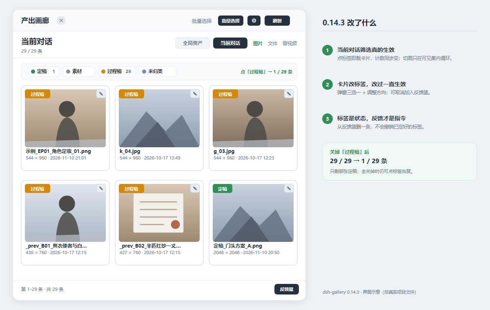
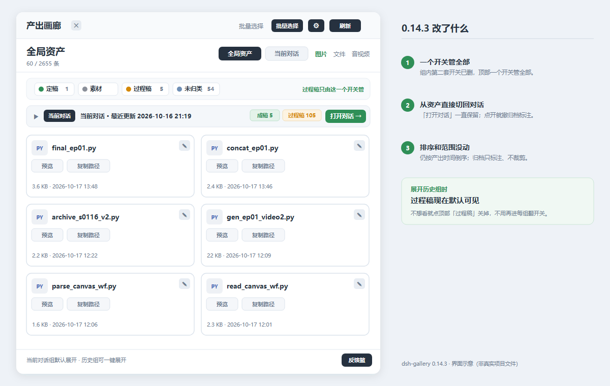
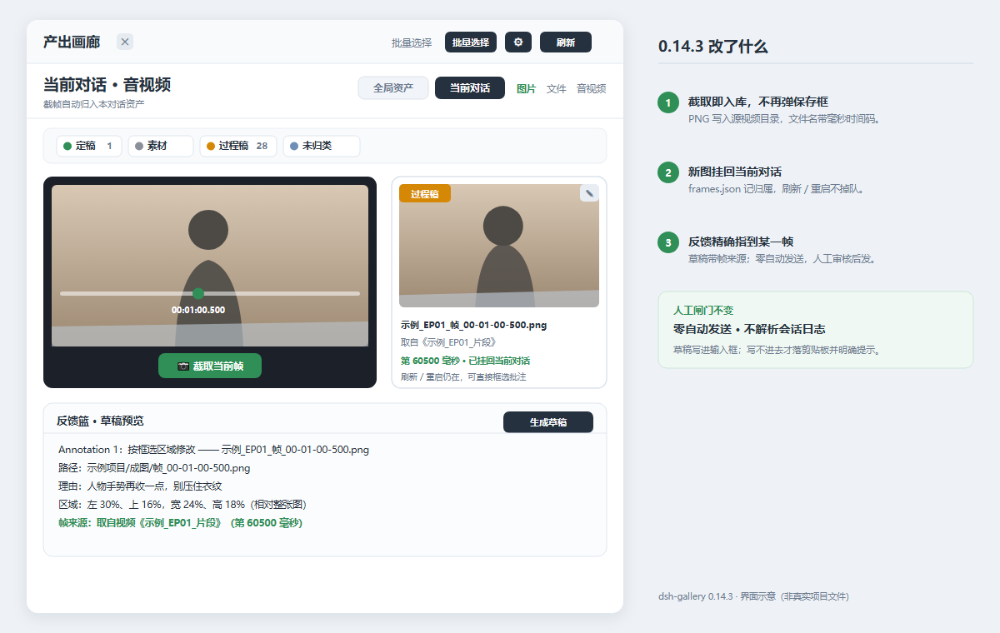
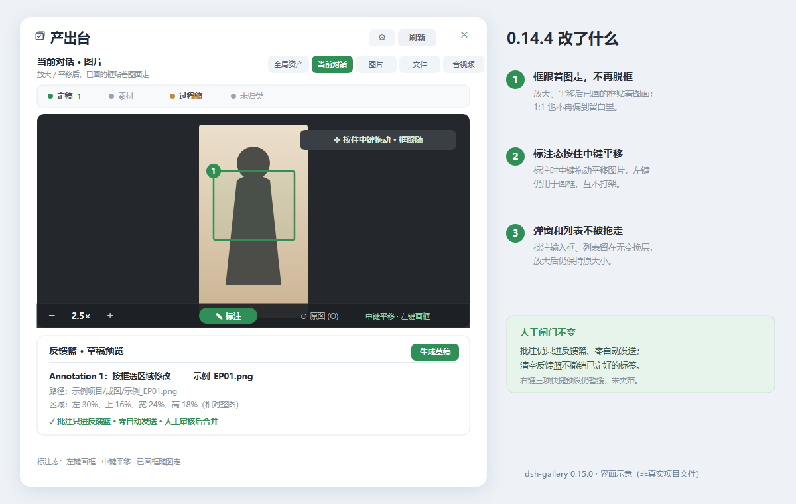
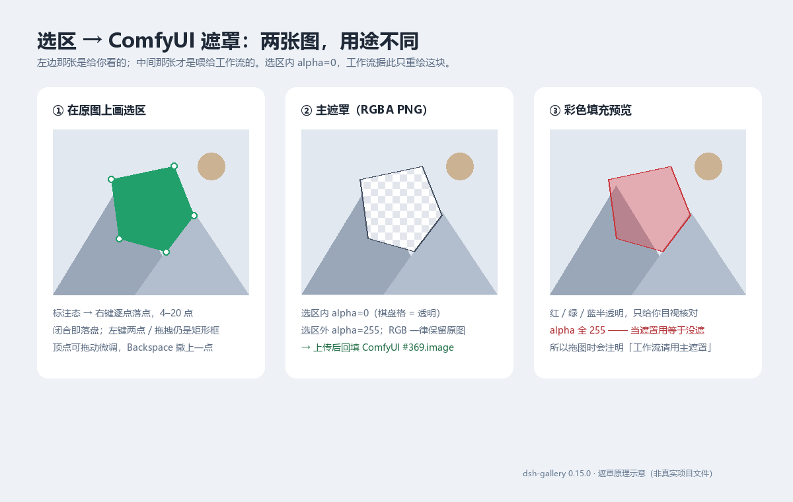
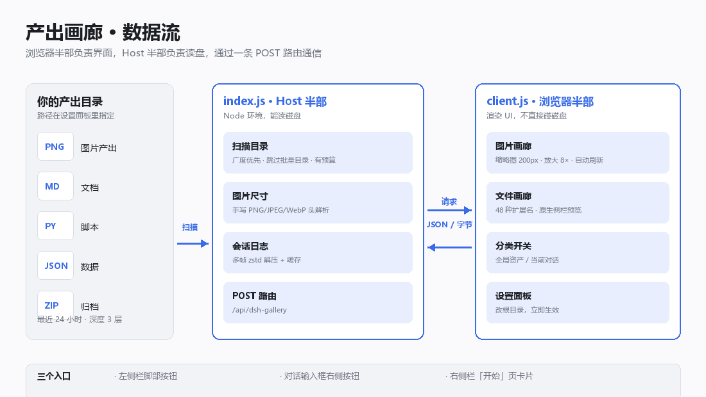

# 产出台 · DeepSeek Harness (DSH) 插件

> **核心问题：Agent 干活的过程是黑箱。**
> DSH 默认**只在任务结束时**才列出产出的文件名和路径 —— 中间生成的东西你看不见，
> 出了偏差只能等它跑完再返工。
>
> 这个插件把产出目录变成右侧栏里的**实时画廊**：图片生成就可见、文件点开就预览、
> 视频音频能在面板里直接播放并拖进度条，
> **让你在任务进行中就能看到产出、当场校验，而不是结束后才发现做错了。**
>
>
> 🎬 **看 2 分钟视频了解它怎么用**：[B站 · 产出台功能演示](https://www.bilibili.com/video/BV1wvsq63Eei/)　　时长 110 秒，8 章功能演示。
> 📌 **版本状态（2026-11-27）**：当前版本 `1.6.6`（线上 `1.6.5` 已发布，本版是它的增量）—— ① **新生成的音频不会再「看不见」**：修掉 1.6.5 的回归（无归属的新文件被历史池折叠键吞掉，扫描一直是好的，坏在面板不刷新）；② **切视图不再闪红字**：列表超时先静默退避重试（1.2 秒 / 2.4 秒），期间旧列表照常显示，整表刷新加了并发去重；③ **批量选择支持按住左键框选**：选框碰到即选中，卡片上任意位置都能起手；④ **拖到边缘自动滚动**：越靠边越快，到顶 / 到底自停，松手即停；⑤ **Esc 退出批量并清空选择**：弹窗、输入框里的 Esc 仍归它们；⑥ 命令结果里的「裸媒体名 + 清单路径」进精确白名单（30 分钟窗口、只在产出根内，不做目录级放宽）。含 1.6.5 的两个合集与按需刷新、1.6.4 的共用归属、1.6.3 的同名目录提示、1.6.2 的导出记录、1.6.1 的全局对账、1.6.0 的增量刷新修复。本版动了 Host 与前端，需彻底退出 DSH（含托盘）重开。
> 1.4.2 的内容见下方「批量：圈一批，一次处理完」等章节。
> 注：线上 1.4.1 实际只包含「深层交付文件保底」一项，其余资产台改动从 1.4.2 起才生效。
> 1.4.0（2026-11-19）新增右键按住涂抹画遮罩（只描区域外轮廓）+ 卡面「复制文件 / 写进输入框」+ 反馈自动过期 + 临时文件不再漏。
> 1.2.0 新增**前后对比**：两张图叠在同一位置，中间一条滑块左右拖；**放大后两张锁在同一处、分割线留在屏幕上不动**，
> 也能切平铺并排看。批量选两张即可进对比，也可在查看器里挑，候选里带遮罩关系的会排前面。
> 实时看见、当场校验、就地处置已可用；能给 ComfyUI 工作流画遮罩、直接把素材粘进来剪短；
> **助手能自己查资产、按对话标题搜图，还知道你最近看过哪几张、面板正停在什么视图**；**同一张图可连框多处、每处各带说明一并交给助手**。
> 判断只保留两层——原生产出标签（素材 / 过程稿 / 定稿 / 未归类，**可手动改、改过就一直生效**）与反馈篮（人工审核合并发送）。
> **表态定性层与「自动递便条」决策包已下线**：前者多余，后者会绕过反馈栏刻意设的人工闸门。详见 [判断分两层](#判断分两层标签--反馈v0142)。
> 视频「📷 截取当前帧」**自动存进当前对话资产**，文件名写清取自哪一帧，可直接框选批注进反馈篮；
> **左键按住拖动＝画矩形框**、**左键单击逐点圈不规则区域＝标记进反馈篮**、**右键逐点或按住涂抹闭合成实心多边形＝生成填充遮罩**；
> 后者导出的就是 ComfyUI 直接能吃的 RGBA 遮罩（另出一张红 / 绿 / 蓝半透明填充预览供目视核对）。
> **双击图片卡片**会把「文件名 + 绝对路径 + 主遮罩」写进对话框输入框（只写草稿，**不自动发送**）；
> 拖图仍会带图片本体，但 Windows 绝对路径在拖放通道里会被清洗，需要完整路径请用双击。
> 图上**批注框跟随缩放平移**（放大后圈选仍落在原图同一处）；**标注态按住鼠标中键拖动**即可平移图片、已画框跟着走。
> **`Ctrl+V` 直接在资产区粘贴素材**（图片/文件都行，标「素材」），**落在鼠标所指的那个对话组**；图片查看器有**带取色放大镜的裁剪**（绿框八向手柄、显示裁剪尺寸与光标处坐标色值），音视频播放器有**入点/出点选段裁剪**，产物归素材来源的那个对话、自动标「素材」。

[](#)
[](LICENSE)
[](#技术说明给想改代码的人)
[](#兼容性)
[](#)

**关键词**：DeepSeek Harness 插件 · DSH plugin · 产出台 · output gallery · 图片画廊 · image gallery · 文件预览 · file preview · **音视频画廊 · media gallery · 视频预览 · video preview** · 侧边栏面板 · sidebar panel · Agent 产出管理 · output artifacts · **产出标签 · asset label · 手动改标签 · manual label · 反馈篮 · feedback basket · 批注 · annotation · region selection · 截帧 · frame capture · 批注跟随 · annotation follow · 中键平移 · middle mouse pan · 批量处置 · batch actions · 粘贴素材 · clipboard paste · **单文件复制 · copy file · 批量复制 · batch copy · 文件拖放列表 · file drop list · 跨对话资产调动 · cross-chat assets** · 图片裁剪 · image crop · 放大镜 · magnifier · 音视频裁剪 · media trim · ffmpeg**

### 界面一览

> 以下为界面示意，文件名与项目名均为通用示例，不展示真实项目内容。

**① 当前对话**：写盘即可见；顶部四个标签点一下就筛，卡片右上角「✎」改标签（改过一直生效）。



**② 全局资产**：按会话分组，当前对话置顶；从资产直接「打开对话」切回去。



**③ 截帧入库**：视频「截取当前帧」自动存进当前对话，文件名带毫秒时间码，可框选批注并带帧来源进反馈篮。



**④ 标注跟随**：放大 / 平移后已画的框贴着图面走、不脱框；标注态按住鼠标中键拖动平移，左键仍用于画框。



**⑤ 选区 → 遮罩**（原理示意）：左边是给你看的选区，中间那张 RGBA 主遮罩才是喂给工作流的 —— 选区内 `alpha=0`、外部保留原图；右边的彩色填充只用于目视核对，不能当遮罩用。



---

## 它解决什么问题

### 痛点：任务跑完你才知道结果

让 Agent 出 30 张图、改一份报告、跑一段脚本 —— 它埋头干几分钟甚至几十分钟，
你**看不到中间产物**。等到最后它念一串路径，你才发现：

- 第 3 张图的风格就跑偏了，30 张全废
- 报告第 2 段引用了错的资料，整篇要重写
- 脚本输出了 50 个中间文件，你不知道哪个是最终版

**返工成本是「一次性验证」的好几倍。**

### 解法：把产出目录变成实时画廊

插件**直接盯磁盘上的产出目录**（Agent 真正写文件的地方），做成右侧栏画廊：

| 效果 | 说明 |
|---|---|
| **图生成就可见** | 每 5 秒自动刷新，缩略图实时滚动，不顺眼当场喊停 |
| **文件点一下就开** | 调 DSH **原生侧栏预览**（Markdown 渲染、代码高亮都是 DSH 自己的） |
| **只看本对话的** | 多个对话混在一起时，按「当前对话」筛，一眼分清谁做的 |
| **过程产物也算** | 脚本跑出来的中间图、Agent 打开看过的图，都算本对话产出 —— **过程不黑箱** |

### 和市面上的「对话图片查看器」不一样在哪

| | 常见的对话图片灯箱 | 这个插件 |
|---|---|---|
| **看哪里** | 对话里的图片附件 | **磁盘上的产出目录**（Agent 真正写文件的地方） |
| **能看什么** | 只有图片 | 图片 + **49 种文档/代码/数据文件** |
| **怎么打开文件** | 无 | **调 DSH 原生侧栏预览** |
| **多个对话混在一起** | 不区分 | **可按「本对话产出」筛** |
| **过程产物** | 看不到 | **脚本生成的中间图也能看到** |

> **一句话安装**：解压后在该目录执行 `node install.mjs`，然后重启 DSH。
> 详细步骤见[安装](#安装)，常见问题见[已知限制](#已知限制)。

---

## 功能

### 图片画廊

| 能力 | 说明 |
|---|---|
| **自动刷新** | 每 5 秒轮询，查看大图时自动暂停，不打断 |
| **缩略图** | 客户端 canvas 压缩到 200px（不是原图直塞），并发闸门 4，进入视口才加载 |
| **放大查看** | 滚轮缩放（最大 8×，**以光标位置为中心**）、左键或中键拖动平移；标注态左键留给画框，改按**中键**平移 |
| **看原图** | 缩略图右键「查看原图」直接按原图像素打开；查看器内切换原图/预览（底部按钮、右键、`O` 键），**切换时保留缩放与位置**；按需加载并显示进度，不预加载 |
| **音视频画廊** | 视频/音频独立第三栏；视频首帧缩略图（进入视口才抽帧）；点击面板内播放（原生 `<video>`/`<audio>`，支持拖动进度条）；体积上限 200 MB 可调 |
| **右侧控制列** | 放大后出现 `▲` / `▼` 按钮 + 轨道 + 滑块，**没有鼠标也能操作** |
| **键盘操作** | `↑↓` 平移、`←→` 切图、`+/-` 缩放、`0` 复位、`O` 切原图、`Ctrl+C` 复制当前文件、`Esc` 退出 |
| **拖到对话**（v0.15.0） | 拖卡片、或点查看器工具条上的「⇥ 拖到对话」，输入框自动填入 `产出台·<文件名> ｜ 路径=<绝对路径> ｜ 主遮罩=<对应遮罩>`。**只填不发**；宿主不接时退化为复制到剪贴板并提示 |
| **退出回位** | 单击退出，回到原来那张缩略图的**精确位置**，不是列表顶部 |
| **复制资产**（v0.16.0） | 卡片右键「📄 复制文件」把**文件本体**写进系统剪贴板；或「批量选择」勾选多张 → 批量条「⧉ 复制所选文件 (N)」。可在别的对话、资源管理器或预处理工具里粘贴，**只复制不移动、零自动发送**。**v1.4.x 起文件卡片上的按钮就是这条**（原来是「带路径复制」长文本），图片卡片右上角也有一个同样的 ⧉ 图标，不必再右键。**v0.16.3 起，在放大查看器里直接 `Ctrl+C`（或工具条「⧉ 复制」）就复制当前这一张** |
| **粘贴素材**（v0.16.0 / 落点 v0.16.2） | 鼠标放在资产区，`Ctrl+V` 把剪贴板里的**图片、音视频、任意文件**直接粘进来；右键空白处也有「粘贴」。落**鼠标所在的对话组**（不在任何组内则落当前对话）并自动标「素材」，**只入库不发送** |
| **图片裁剪**（v0.16.0） | 查看器工具条「✂ 裁剪」：拖框 + **正方形像素放大镜**（从全分辨率源图取 4× 硬边像素格（37×37 源像素，方形 148px），绿色十字线标出光标像素）+ **左上角裁剪尺寸**（裁完多少原图像素）+ **光标处坐标与色值**（`Ctrl+C` 复制色值）；绿框四角与四边中点共 **8 个手柄**，边中点只沿单轴拖，**确认面板固定在窗口右下角**（拖动时先隐藏、松手才出现，不挡预览），确认后裁 PNG 落**源图同目录**、归到该图所属对话组，自动标「素材」 |
| **音视频裁剪**（v0.16.0） | 播放器工具条「✂ 选段」：时间轴拖入点/出点，播放自动从入点起、到出点停，拖端点时画面跟随（轨道有白色播放头）；保存后 ffmpeg 切段落源同目录，自动标「素材」 |

### 素材进来与剪短（v0.16.0；落点规则见下）

> **粘贴落哪一组**（v0.16.2）：鼠标停在哪个对话组，就落进哪个组；**在放大查看器 / 播放器里操作时，优先归素材来源的那个组**；鼠标不在任何组内时退回当前对话。提示条会写明「已粘贴 N 个文件到「组名」」，不会再出现「粘到哪去了」说不清。

| 场景 | 怎么做 | 结果 |
|---|---|---|
| 网上看到一张图 / 截图 | 鼠标移进资产区 → `Ctrl+V` | PNG / JPG / WebP / GIF / BMP 都收，按真实格式存（不转码、不缩水），落**鼠标所在对话组**，自动标「素材」 |
| 资源管理器里复制的**音视频 / 文件** | 在资源管理器 `Ctrl+C` → 鼠标移进资产区 `Ctrl+V`，或右键「粘贴」 | 原文件复制进**鼠标所在对话组**，自动标「素材」；`.mp4` / `.MP3` / `.dwg` / `.zip` 都行 |
| 把某个对话的资产调到别的对话 | 卡片右键「📄 复制文件」→ 把鼠标移到目标对话组上 → `Ctrl+V` 或右键「粘贴」 | 副本落**指针所在那一组**（不必真切换会话，切了也对），自动标「素材」，**原件不动** |
| 一次调动多张 | 「批量选择」勾选 → 批量条「⧉ 复制所选文件 (N)」→ 目标对话里粘贴 | N 个文件一次性入库，重名自动加 `-2`、`-3`，不覆盖 |
| 拿不到路径的 Blob | — | 先按位图直存；若只是「有名字没内容」的空壳，自动改读系统剪贴板按真实路径复制 |
| 只想留图里一小块 | 查看器 →「✂ 裁剪」→ 拖框（四角 + 四边中点共 8 个手柄可微调）→ 确认 | `裁剪-<原名>_<时间戳>.png` 落源图同目录，归到该图所属对话组 |
| 视频/音频只留一段 | 播放器 →「✂ 选段」→ 拖入点/出点（画面跟着走）→ 播放从入点起、到出点自动停 → 保存 | `裁剪-<原名>_<时间戳>.<原扩展名>` 落源文件同目录，归到素材所属对话组 |

**音视频裁剪的精度说明**：默认走 `-c copy` 流拷贝（近无损、秒级），但 `copy` 只能从**关键帧**起切，
所以后端会用 `ffprobe` 量真实时长，**偏差 > 0.5s 就自动重编码到精确切点**（`mode` 字段会告诉你是 `copy` 还是 `reencode`）。
实测 6 秒测试片切 1.5–4s：`copy` 得到 0–4s（4.0s），兜底后回到 2.5s。

### 框选批注 → ComfyUI 遮罩（v0.15.0）

给「局部重绘 / 移除」这类工作流补上人画的遮罩，不必切到 ComfyUI 画布。

| 步骤 | 行为 |
|---|---|
| ① 进入标注 | 图片查看器里点「标注」。**左键按住拖动 = 矩形框**（可写说明，老行为）；**左键单击逐点落点、闭合 = 不规则区域标记，直接进反馈篮**（不生成任何文件）；**右键逐点落点、闭合 = 实心多边形填充选区**（闭合即导出遮罩）；**右键按住一抹 = 同一件事但不用一个个点**（松手先看到填充，且只保留**区域外轮廓**、内部交叉的笔迹不计入，确认后才导出）。两种多边形都是 4–20 点，顶点可左键拖动微调，`Backspace` 撤上一点、`Escape` 清空、`Enter` 闭合 |
| ② 导出 | 批注列表里这条框右侧的「**导出遮罩**」按钮；箭头 / 纯文字标注没有面积，不显示。多边形保存时即落盘，无需再点导出 |
| ③ 落盘 | 生成与原图**同尺寸**的 RGBA PNG，写在原图同目录，文件名如 `定稿_遮罩_x25-y50-w20-h25.png` / `定稿_遮罩_x25-y50-w20-h25-多边形.png`（坐标是选区的归一化百分比）；同框重复导出加 `-2`，不覆盖旧遮罩 |
| ④ 彩色预览 | 多边形操作条上可切**红 / 绿 / 蓝**：另存一张 `<遮罩名>_红填充预览.png`，选区内叠半透明纯色、轮廓略深（线宽随图像尺寸自适应，缩放后约 1.5 px）。**只用于目视核对**，主遮罩一个像素都不改 |
| ⑤ 入库 | 主遮罩登记进 `dsh-gallery-frames.json`（`kind:'mask'`），刷新后仍挂在**当前对话资产**里；同一目录下别的图（含他人拷进来的素材）也会出现在当前对话，标「素材」 |
| ⑥ 进草稿 / 进对话 | 原图的反馈条目自动带出「**遮罩来源**」一行（路径 + 编码说明）。也可以直接把图**拖进对话框**：名字自动带上文件名、绝对路径、对应主遮罩名，并在输入框写清「工作流请用主遮罩，预览仅供目视」。**两种都只到草稿 / 输入框为止，由你确认后手动发送**，插件不会自动发，也不会自己去调 ComfyUI |

**2026-11-15 新分工**：左键单击圈出的不规则区域只是「标记」——闭合后立刻进反馈篮，
篮子里会标「不规则区域 · N 点」，说明可填可不填，**不会生成任何遮罩图片**，也不会自动发送。
要真正出 ComfyUI 用的遮罩，请用右键逐点圈选或按住涂抹（闭合即落盘）。左键按住拖动的矩形仍可写说明，
也仍能从批注列表里点「导出遮罩」。

**三种「状态确认框」位置统一在窗口右下角**（2026-11-16）：矩形框的说明输入框、左键区域标记的操作条、
右键填充遮罩的操作条，离右边和下边**各 20px**、宽**都是 300px**，出现时同一条淡入；
操作进行中（拖框、拖顶点）先让开，松手才回到原位。左上批注列表与右上导出结果提示同样按 20px 网格对齐。
这样换一种圈法不用重新找按钮 —— 确认框永远在同一个角落，也永远不压住正在圈的那块。

**编码契约**（本机实证）：ComfyUI 官方 `LoadImage` 与本机孤海 `LoadImageGoohai` 的 MASK 输出都是
`1 - alpha/255`。所以遮罩 PNG 只需「**选区内 alpha=0、选区外 255，RGB 逐像素保留原图**」——
选区内即待重绘区域，IMAGE 输出仍是完整原图。这与 `clipspace-painted-*` 涂鸦遮罩等价，
但不必复刻画布交互，也不用改那两条工作流：把导出的 PNG 上传进 ComfyUI `input/` 后回填
`#369.image` / `#193.image` 即可（这一步由 Agent 按草稿执行）。

> ⚠️ **别把彩色填充预览图喂给工作流**：它是 RGB 合成图、alpha 全 255，`MASK` 会恒为 0。拖图时名字里已经写明「工作流请用主遮罩」。

**已验证到什么程度**：完整 25 节点 Qwen2.1 局部重绘工作流真跑通过 —— 真实照片里选一块区域换成指定物体，
**选区外像素平均绝对差 0.00**；12 点多边形选区与手画框 IoU 0.891，输出与 ComfyUI 手画遮罩的验收图**逐像素一致**。

**边界**：矩形框与多边形两条路都可用；自由笔刷 / 橡皮 / 笔刷大小仍未做（多点闭合已覆盖实际需求）。
原图像素超过 2400 万或导出 PNG 超过 24 MB 会被拒绝；批注本身依旧只在内存，落盘的只有遮罩与预览图。

### 前后对比（v1.2.0）

局部重绘跑完，常要拿「改前 / 改后」并排对一眼。这一节讲怎么在查看器里直接比，不用开图翻来翻去或自己拼图。

| 步骤 | 行为 |
|---|---|
| ① 选两张 | **批量勾选两张图** → 工具条出现「⇄ 对比两张」，点一下直接进；或在查看器工具条点「⇄ 对比」，从候选网格里一张张挑 |
| ② 智能推荐 | 候选面板前几张标「推荐」，按可靠度排：有遮罩关系（圈过遮罩的原素材 ↔ 产物）＋1000 ＞ 同尺寸 ＋500 ＞ 时间更晚 ＋120 ＞ 文件名主干一致 ＋80；最多 12 个，不同尺寸会明确标出来 |
| ③ 滑块（默认） | 左「前」右「后」，拖中间分割线；`←` `→` 微调（按 `Shift` 大步），`X` 对调左右，`T` 切模式 |
| ④ 平铺 | 左右各一格并排，共用同一组缩放平移；滚轮以**光标所在那一格的中心**为不动点，两格同步 |
| ⑤ 放大看细节 | 对比态下滚轮正常缩放（最高 8 倍），两张始终锁在同一处、分割线留在屏幕上不动，方便看颗粒 |

**几个边界**：对比中批注层 / 裁剪层让位（三者都要独占指针）；`Esc` 先退对比、不会顺手关掉大图；左右键归分割线、不再翻图；两张尺寸不同会给提示、位置只作参考；退出 / 换图会释放对比图的内存。

### 文件画廊

列文档 / 代码 / 数据 / 压缩包 / 链接 / 设计文件，共 49 种扩展名（**不含图片**，图片归图片画廊）。

| 操作 | 行为 |
|---|---|
| 点整张卡片 / 按 `Enter` | 用 DSH **原生侧栏**打开预览（Markdown 渲染、代码高亮都是 DSH 自己的） |
| 点「📝 写进输入框」 | 把「文件名 + 绝对路径 + 主遮罩」写进对话输入框草稿（**只写不发**，写不进就退到剪贴板）；与双击卡片同一条链路 |
| 点「⧉ 复制文件」 | 复制**文件本体**到系统剪贴板（和右键那条同一个通道），按钮变 `✓ 已复制` 反馈 1.6 秒；在 WorkBuddy / 微信对话框按 `Ctrl+V` 直接粘出文件 |
| 右键「📄 复制文件」 | 同上，复制**文件本体**到系统剪贴板，可粘到资源管理器、别的对话或预处理工具 |
| 点「📂」 | 在资源管理器里定位该文件 |

### 音视频画廊

列视频 / 音频，共 16 种扩展名（视频 7 种、音频 9 种），**独立第三栏**，不混进文件列表。

| 操作 | 行为 |
|---|---|
| 点整张卡片 | 在面板内弹出播放器 |
| 视频卡片 | 显示**首帧缩略图**（进入视口才抽帧，避免一次解码几十个视频） |
| **拖进度条** | ✅ **实测 127 MB 可拖；GB 级未做大小分档** —— 面板内播放走 blob（整包载入后交给浏览器，可任意 seek） |
| **点开到可播** | ✅ 1.1 MB 视频与 96.5 秒音频约 250 ms；**127 MB 实测 502 ms，可正常拖动**；GB 级未做大小分档 |
| 播放器里「📷 截取当前帧」 | **自动存进当前对话资产**（视频同目录），不再弹系统保存框；文件名如 `片子_帧_00-12-34-500.png`，精确到毫秒。刷新后这张图就在当前对话组里，可框选批注、写进反馈篮，草稿会注明取自哪段视频的哪一帧 |
| 浏览器解不了格式 | 显示提示 +「▶ 用系统播放器打开」/「📂 打开所在文件夹」两个按钮 |

> **技术说明：媒体走双通道**
>
> 1. **独立 Range 路由**（`ctx.webServer.register`，Node 原生 `req`/`res`）：
>    支持 `Range: bytes=...` 的常规区间、开放区间、后缀区间，以及 416 不可满足。
>    用于**视频首帧缩略图抽取**、直链读取与其他需要分段读取的场景。
> 2. **面板内播放走 `/api` 网关的 `raw` + blob**：`POST {op:'raw'}` 取完整字节，
>    `URL.createObjectURL(blob)` 交给 `<video>` / `<audio>`。
>
> **为什么播放要单独走 blob**：DSH 桌面宿主在转发 Host 响应时会**剥掉
> `Content-Length`**（见 `app.asar` 的 `lib/main.js`，`WITHHELD_RESPONSE_HEADERS`），
> Chromium 因此拿不到文件总长度，`<video>.seekable` 恒为 `[0,0]` ——
> 能播但进度条拖不动。blob 是完整数据在内存，Chromium 知道确切大小，`seekable` 覆盖全长。
>
> **代价**：播放时**整包载入内存**（等于文件大小）。实测 127 MB 用时 502 ms；
> GB 级文件暂未做大小分档，仍会走 blob。
>
> 体积上限默认 200 MB，可用 `maxMediaBytes` 调整。

### 右键菜单（图片 / 文件 / 音视频通用）

在任意卡片上**右键**：

| 项目 | 行为 |
|---|---|
| **🚫 隐藏** | 从列表移除，**文件仍在磁盘上**（记录在 `dsh-gallery.json` 的 `hidden` 数组） |
| **📂 打开所在文件夹** | 资源管理器定位到该文件 |
| **⧉ 复制路径** | 复制绝对路径到剪贴板 |
| **🗑 删除文件** | **二次确认**后移到回收区（`<DSH_HOME>/gallery-trash/`），可 **Ctrl+Z 撤回**，默认留 7 天 |

> ⚠️ 删除做了三层保护：前端确认弹窗 → API 强制 `confirm: true` → 路径越界校验。
> **v1.6.0 起删除不再直接删字节**：先搬进回收区，撤销就是把这一批搬回原位（原产出根也一并记着，多根环境回得去）。
> 撤销只补「当前没有」的登记，原位已有同名文件会报冲突、绝不覆盖；回收区保留期由 `trashTtlHours` 控制（默认 168 小时，0 = 永不清理）。

### 分页

三个画廊都是**每页 60 条**，网格下方**常驻页码条**：

```
第 1–60 条 · 共 114 条   还有 54 张
                  ‹  1  2  ›
```

- 页码点击切页，页数多时折叠为 `1 … 5 6 7 … 20`
- 切换「图片/文件」或「全局/当前对话」时自动回到第 1 页
- 列表右侧另有 `▲` / `▼` 滚动辅助列（无滚轮时用）

### 视图范围与标签开关

```
[全局资产]  [当前对话]
```

- **全局资产**：所有扫描目录下的全部内容，按时间倒序
- **当前对话**：只显示**本对话真正产出过**的文件 —— 通过解析 DSH 会话日志得出，不是按时间瞎猜

「当前对话」的产出判定覆盖三类来源：

| 来源 | 为什么算 |
|---|---|
| `write` / `edit` / `present` | Agent 直接写文件 / 声明交付，路径必是产出 |
| **`read_image` 打开过的图片** | Python 等**脚本生成的图**不在 `write` 调用里，但 Agent 一定会打开看效果 |
| **子智能体会话里的产出** | 子智能体是独立会话，按 `parentSession` 合并它的产出路径；**全局按对话分组也合并进父对话那一组**（v1.5.0）—— 两套尺子不一致时，同一个对话在全局只剩自己亲手产的几张，看着像资产丢了 |
| **同目录下的外部素材**（v0.15.0） | 别人拷进产出目录、或不是本会话生成的图，按「与原图同目录」放行并标 **素材** —— 不再只显示自己产出的那几张 |

> 这条设计是为了「任务进行中即时可见、便于及时校正」——
> 中间产物、调试图、脚本输出都能在过程里看到，而不是等任务收尾。

顶部那一排色块（`定稿` / `素材` / `过程稿` / `未归类`）**是可点开关**，点一下隐藏该类、再点恢复。
它们代表的是**机器标签层**——插件按会话日志自动判的，随时可以不信。
你自己定了性之后，筛选改按你的结论走，详见[判断分两层](#判断分两层标签--反馈v0142)。

> **三类资产各记各的开关**（v0.16.5）：`图片` / `文件` / `音视频` 的显隐互不影响。
> 文件通常只看终稿，关掉过程稿和素材之后，切回图片不会连带把图片的过程稿也关掉；
> 切回来就是你上次在那一类里的样子。仍然不持久化——重开面板从全显示开始。

### 多扫描目录

DSH 每个会话有独立的 cwd，产出可能落在任意工作区（如 `G:\DSH任务文件\xxx`），
不一定都在 `G:\DSH产出`。所以插件支持**配置多个扫描目录**：

```json
{
  "roots": [
    "G:/DSH产出",
    "G:/DSH任务文件"
  ]
}
```

设置面板（⚙）里可直接增删，每项显示 `✓`（存在）/ `✗`（缺失标红）。改完立即生效。

### 产出根目录可配置

**装上不会空白。** 插件按这个顺序确定扫描目录：

1. **面板内设置的多目录列表**（最高优先，改完**立即生效，无需重启**）
2. 设置或 `cordis.patch.yml` 里的单个 `root`（旧写法，兼容）
3. **自动探测**：先找 `~/DSH产出`、`~/Documents/DSH产出`、`~/Desktop/DSH产出`、`~/Downloads/DSH产出`，再遍历各盘符找 `<盘符>:\DSH产出`（循环 A–Z，代码里不写死任何字母，所以装在哪个盘都能自动找到）

一个目录都没有时，面板会直接给出「修改产出根目录」的入口。

### 隐藏管理

设置面板（⚙）里有「**已隐藏 N 个 · 全部恢复**」：

- 列出被隐藏的文件（前 10 个，悬停看完整路径）
- 点「全部恢复」一键清空隐藏列表，被隐藏的重新出现
- **恢复不删除文件**，只是清掉记录

### 两个合集：已归档 / 已隐藏（v1.6.5）

全局资产会按对话分组，用久了组会很多（本机 56 组）。列表底部有两个**各自独立**的折叠合集：

- **已归档对话**：宿主官方标记 `archivedSessionIds` 的对话**自动**进这个合集，不用手动操作；
  归档只影响列表位置，组头原有的「已归档」徽标与「打开对话」入口照旧保留。
- **已隐藏对话**：在全局资产里**右键任意对话行** → 「隐藏当前对话」，这一行立刻移到
  **「已隐藏对话 N 个」**（默认收起，不占位置）；展开合集后**右键** →
  「在全局列表显示」，放回原位置。
- **右键直达对话**：同一个右键菜单里还有「打开对话」，与「隐藏当前对话」并列 ——
  不必先展开组就能切过去；复用展开组里那颗按钮的调用与反馈。当前对话不给这一项。
- 既归档又被隐藏的按**隐藏优先**只进隐藏合集，同一组不会在两个合集里出现两次；
  「历史资产」池不参与分区。
- 隐藏记录存在设置文件的 `hiddenSessions` 里，关掉 DSH 再开还在；
  **只动列表，不动文件、不动会话**：助手照样能搜到这些对话的资产，它们也照旧参与
  扫描与交付清单。删除/隐藏单个文件是另一套记录（`hidden`），两者互不干扰。

### 收起来的对话不占资源（v1.6.5）

这两个合集里的组**默认继承上次扫描结果**：每秒的增量刷新会跳过它们，
不会为看不见的组反复触发全库扫描（本机 6941 张 / 约 5.8 秒）。
**只有点开其中一个对话时，才对那一个刷新一次**；同一组一次会话内只自动刷一次，
拿不到新数据就保留上次那份，绝不把整组抹空。**历史资产池**（3000+ 张、没有 sessionId）
也用 `__history__` 键收进同一套，默认跳过轮询、点开才刷一次；
手动点顶部「刷新」依然全量。

顺手说清「共用」是什么意思：同一个**文件**（同一路径，不是同名）被 ≥2 个对话
记录过，卡片上标 `共用 8 个对话`；组头**默认只留一个琥珀小圆点**，悬停组头才展开
`共用 136 张` 与完整口径。同名但不同路径的两份真文件
**不**算共用 —— 它们各有自己的一行 `同名 2 份 · 所在目录`。

### 批量选择：按住左键框选、拖到边缘自动滚、Esc 收手（v1.6.6）

批量选择下**按住左键拖动就是框选**，不再把图片拖走：从**卡片上任意位置**起手都行，
选框**划过哪张就选哪张**（部分相交即算），松手结束。

- **拖到边缘自动滚动**：鼠标停在列表上下边缘不动，列表自己滚，越靠边越快；
  到顶 / 到底自动停，松手立即停，选框顶边不会跟着漂。
- **加选**：起手时已选中的保持不变；把框拖回去，本次框到的会自动取消，不会越拖越乱。
- **不抢手势的地方**：卡片上的小按钮（改标签 / 勾选 / 复制 / 抓帧）、滚动条、
  触屏滑动（仍走原生滚动）。
- **Esc**：清空已选并退出批量，与批量条上「清空选择」按钮是同一个动作。
  大图、标签弹窗、删除确认、右键菜单开着时，Esc 先关那一层、不动你的选择；
  光标在输入框里时也不打断输入。

### 列表不会再因为一次超时被整个清空（v1.6.6）

切换「当前资产 / 其他对话」时偶尔弹出的「扫描超时了…宿主正忙时会这样」，
原因**不是扫描慢**（实测单次 0.1–0.2 秒、切进 26 MB 超长对话 0.6–1.8 秒），
而是宿主单进程偶发排队超过前端 12 秒硬超时；而旧实现在一超时就把**整屏列表换成一页红字**
并等人手点「重试」，下一轮轮询成功又自己恢复 —— 看着就像「卡 5 秒」。

现在超时先**静默重试两次**（1.2 秒 / 2.4 秒），期间旧列表照常显示、数据到了平滑替换；
整表刷新也加了并发去重，不会因为每秒轮询叠出多个请求。
三次都超时才显示失败页 —— 那是宿主真卡死时才该出现的画面。12 秒阈值与文案一个字节没改。

### 新写进磁盘的音频 / 视频会自己出现（v1.6.6）

Agent 用脚本新写进产出目录的音频、视频，即使还没登记归属，
也会在下一次增量刷新时出现在「当前对话 / 音视频」里，不用手动点刷新、也不用重开面板。

同时补了一条保底：脚本把输出目录写在正文里、命令行只有 `& $py "...\02_tts.py"` 这种形态时，
从命令结果里的「裸媒体名 + 清单绝对路径」拼出**精确文件白名单**（30 分钟窗口、落在产出根内、
真实存在的媒体才算），主日志与子智能体日志都认。刻意不做目录级放宽，避免把同目录的历史文件一起吸进来。

---

## 安装

### 前置

已安装 DSH 桌面版或 Web 版。

### 方式零：DSH 插件页一行装（最省事）

打开 DSH → **插件页** → **添加插件** → **安装第三方插件**，在输入框粘贴：

```
github:Hope2023Dcr/dsh-gallery
```

点安装。DSH 会自动从 GitHub 拉取并装好，装完重启 DSH。

> 想锁定版本（推荐，避免仓库更新导致行为变化）：
>
> ```
> git+https://github.com/Hope2023Dcr/dsh-gallery.git#260a8dadfb39b393fdb8e85b182dd1f871e3ea43
> ```

> 上面那个 commit 是 **v0.14.1** 的历史基线（表态层当时还在）。正式版可用
> `git+https://github.com/Hope2023Dcr/dsh-gallery.git#v1.6.6` 锁定版本。
> **更推荐直接用 npm**（`npm i dsh-gallery`）—— 版本号跟着 `latest` 走，不用每次手工核对哈希。

> ⚠️ 这种方式需要**能访问 GitHub**。DSH 的「国内镜像」只代理 npm 包，不代替 GitHub 下载。

### 方式一：一键脚本（推荐，可离线）

下载本仓库（`Code → Download ZIP`，或 `git clone`），解压后**在解压出来的目录里**执行：

```bash
node install.mjs
```

脚本会自动：

1. 定位 DSH 主目录（优先 `DSH_HOME` 环境变量，回退 `~/.dsh`）
2. 列出可用 profile 让你选（只有一个时直接用它，多个时默认 `desktop`）
3. 校验源文件齐全
4. 复制到 `<profile>/node_modules/dsh-gallery/`
5. 在 profile 的 `package.json` 的 `dsh.profile.bundles` 里注册
6. **自动备份原 `package.json`** 为 `package.json.bak-dsh-gallery`

可选参数：

```bash
node install.mjs --profile desktop   # 指定 profile
node install.mjs --dry-run           # 只看会做什么，不写入
```

> 脚本幂等：重复运行不会重复注册 bundle。

**装完必须重启 DSH**（不是刷新页面）。

### 方式二：手动安装

**1. 找到你的 profile 目录**

| 平台 | 路径 |
|---|---|
| Windows | `%USERPROFILE%\.dsh\profiles\desktop` |
| macOS / Linux | `~/.dsh/profiles/desktop` |

> 如果 `desktop` 不存在，看你实际用的 profile 名（`profiles/` 下有什么就用什么）。

**2. 复制文件到插件目录**

目标：`<profile>/node_modules/dsh-gallery/`

需要放进去的文件：`index.js`、`client.js`、`package.json`、`cordis.patch.yml`、`icon.svg`、`locale/`。

Windows PowerShell：

```powershell
$target = "$env:USERPROFILE\.dsh\profiles\desktop\node_modules\dsh-gallery"
New-Item -ItemType Directory -Force -Path $target | Out-Null
Copy-Item index.js,client.js,package.json,cordis.patch.yml,icon.svg -Destination $target
Copy-Item locale -Destination $target -Recurse
```

macOS / Linux：

```bash
target=~/.dsh/profiles/desktop/node_modules/dsh-gallery
mkdir -p "$target"
cp index.js client.js package.json cordis.patch.yml icon.svg "$target/"
cp -r locale "$target/"
```

**3. 在 profile 的 package.json 里注册**

编辑 `<profile>/package.json`，在 `dsh.profile.bundles` 数组里加一项（**不是顶层 `bundles`**）：

```json
{
  "dsh": {
    "profile": {
      "bundles": [
        "dsh-gallery"
      ]
    }
  }
}
```

**4. 重启 DSH**

必须**完全退出**再打开（不是刷新页面）。Host 半部只在进程启动时加载。

**5. 打开面板**

三个入口任选：

- 左侧边栏脚部的 `▦` 按钮
- 对话输入框右侧的 `▦` 按钮
- 右侧栏点 `+`，「开始」页里的「产出台」卡片

**6. 设置产出目录**

第一次打开如果显示「目录不存在」，点面板里的 **⚙ 设置**，填入你的产出目录绝对路径，保存即可生效。

---

## 配置项

编辑 `<插件目录>/cordis.patch.yml`：

```yaml
config:
  # root: 'D:/产出'      # 不填就走自动探测
  maxItems: 60            # 每页显示多少条
  maxDepth: 3             # 向下扫描几层目录
  skipDirs:               # 跳过这些目录（体积大、无产出）
    - node_modules
    - .git
    - ...
```

> ⚠️ **不建议在这里写 `windowHours`。** 它是「扫描多久以内的文件」，代码默认是一整年
> （为了让「全局按对话分组」能覆盖历史对话）。在这里写死 `24` 会让分组只剩当天产出。
> 确实想改的话，写进 `<DSH_HOME>/dsh-gallery.json` 更合适。

改完重启 DSH 生效。**只想改目录的话，建议用面板里的 ⚙ 设置**，那个不用重启。

---

## 已知限制

1. **「当前对话」分类依赖 DSH 会话日志格式。** 它读 `~/.dsh/sessions/<分组>/<sessionId>/session.v4.jsonl.zstd`，解析 `tool/call` 事件。DSH 大版本升级后这个功能可能失效，需要回归验证；其余功能不受影响。
2. **只扫一层层的目录，深度默认 3 层。** 特别深的目录结构会漏。
3. **扫描时间窗口默认一年。** 文件多时会拖慢扫描（已做缓存，稳态约 150 ms）。
4. **文件画廊故意不显示图片。** 图片归图片画廊，避免两边重复。
5. **`reveal`（资源管理器定位）仅 Windows 有效。** 其他平台会走 `xdg-open` 打开所在目录。
6. **「未归类」是诚实的不知道。** 会话日志里查不到归属的文件标为「未归类」，
   而不是猜成某个类别。这类文件多来自早期对话或手动拷入。
7. **批注只在内存里。** 重开面板 / 刷新 / 重启 DSH 会清空（手动标签是落盘的，不受影响）。
   批注属于「这一轮要对 Agent 说的话」，用完即弃，所以没做落盘。
8. **批注框自 v0.14.4 起跟随缩放平移**，放大后圈选也落在原图同一处，不再只能 `1:1` 下圈。
   **标注态下按住鼠标中键拖动可平移图片**（放大后生效），已画框跟着走；左键仍用于画框。
   一个视觉细节：框线用 `non-scaling-stroke` 固定为屏幕像素宽，放大很多倍时框会比画面内容显得细。
9. **遮罩只认一种格式**：与原图同尺寸、RGB 是原图、alpha 二值（选区内 0 / 外 255）。
   彩色填充预览图是给人看的 RGB 合成图，**不能当遮罩喂给工作流**（alpha 全 255，MASK 恒 0）。
10. **拖图带名字依赖 DSH 的 `dataTransfer.files` 通道**。宿主若改成只接受自己的文件令牌，
    名字会退化为「复制到剪贴板」，这时直接 `Ctrl+V` 同样能拿到「文件名 + 绝对路径」。
11. **粘贴落点是「指针所在组」，不是「菜单所在组」**。键盘 `Ctrl+V` 没有位置信息，只能靠鼠标 hover 判断；鼠标不在面板上时 Ctrl+V 不接管，对话输入框照常粘贴。
12. **历史对话的目录已被清掉时，粘贴会按「相对路径 + 第一个产出根」重建目录**（选择恢复而不是拒粘）。若你更希望这种情况直接报错，需要改 `resolveSessionDir` 的兜底分支。
13. **原生 controls 进度条仍显示整段总时长**。选段区间在自绘轨道上看，原生控件无法只显示区间。
14. **目录类剪贴板项不递归复制**，只识别文件；`-c copy` 切点受关键帧限制，偏差 > 0.5s 时后端自动重编码。
15. **放大页 `Ctrl+C` 复制的是文件本体，不是画面像素**（粘贴到资源管理器得到文件，粘到 Word / 微信通常显示为图）。查看器里有选中文本时 `Ctrl+C` 交给浏览器默认复制，不会抢走你要复制的文字。
16. **待处理反馈要「人处理完」才清，Agent 拉取不会清**（v0.16.4）。若你只想留档、不想再留着待处理记录，点「清空反馈篮」即可（界面上的待处理数字角标已于 2026-11-15 下线）；`marks` 与手动标签不受影响。另一个边界：**同一路径只有一条记录，重复判定会覆盖**（不是攒多条互相矛盾的意见）；但 v0.16.5 起**这条记录里可以带多处理解**——同一张图框三处，三处说明与坐标都会一起留下，Agent 也会按三条分别回应。一张图的批注上限 50 处。

---

## 导出交付清单（v1.5.0，v1.6.2 增强）

选一批 → 批量条上点「导出清单」→ CSV 与 JSON 同时落到 `<DSH_HOME>/gallery-exports/`（`~/.dsh/gallery-exports/`）。

| 项 | 说明 |
|---|---|
| **格式** | CSV 给 Excel / WPS 看（**带 UTF-8 BOM**，否则双击打开中文会乱码）；JSON 给下一轮或脚本读 |
| **文件名** | `交付清单_<来源>_<时间>_<分类>_<N>张.csv`（v1.6.2）。来源是「全局资产」或当前对话标题，标题里的 `:` `?` `"` 与换行会清洗掉、超长截到 16 字 —— 多次导出摆在一起能一眼认出谁是谁 |
| **列** | 序号、文件名、相对路径、分类、尺寸、体积、修改时间、来源对话、来源视频、时间码、遮罩、备注 |
| **尺寸从哪来** | 扫描结果本身带宽高就直接用（一次盘都不读）；缺了才读文件头（`regions.js` 的零依赖解析）。实测全库 6930 条，需要读盘补的只有几条 |
| **来源视频 / 时间码** | 截帧才有：`卖炭翁_EP01.mp4 @ 00-02-17-892`，直接写进清单，交给后期不用再翻文件名猜 |
| **重名** | 绝不覆盖：同名自动加 `-2`、`-3` |
| **继承了别的对话的资产** | 只要您**手动选中**了它，就一定进清单（带「继承 / 共享」角标也照导）。只有「不选、按分类整批扫」时才排除，避免父子会话重复计数 |
| **落点为什么不在产出目录** | 清单是 `.csv` / `.json`，而扫描扩展名里正好有这两类 —— 写进产出目录，下次刷新它就成了一个「文件资产」出现在资产台里，越导越多 |

**导出完不用去翻文件夹**（v1.6.0，v1.6.2 补齐「事后」这一半）：底部提示条带四个按钮 ——
「**导出记录**」、「打开文件夹」（新 op `openExportDir`，**只认导出目录**，不接受任意路径）、
「复制路径」、「写进输入框」（只写不发，写不进就退回剪贴板）。

**导出记录面板**（v1.6.2）：标题栏常驻「📁」按钮，随时打开。按时间倒序列出历史清单
（来源 / 时间 / 条数 / 文件名），每条都能重新「写进输入框 / 复制路径」；
文件被移走或删掉会标「文件已不在」。每次导出都会登记到 `gallery-exports/index.json`，
1.6.1 及更早导的旧清单也从文件名里认出时间与条数、标「早期导出」照样可引用。

**和 Agent 的那一半是同一个内核**：模型那边对应的工具是 `gallery_manifest`（只读、不落盘）。
您导出的 CSV 和模型读到的清单，条数、分类计数、来源时间码完全一致 —— 两处都调 `host/manifest.js` 的同一个 `buildManifest()`。

> 想让我「按这份清单接着改」，直接把清单文件路径告诉我，或者让我调 `gallery_manifest` 取同一份数据即可，不必手工抄文件名。

---

## 安全

**风险等级：低～中。** 插件只操作本机产出目录、不上传任何数据；但**按需会调起四类本机程序**——
都不是「任意命令执行」（固定程序名 / 内置脚本、参数受约束、须你主动操作才触发）。
旧版这里写「唯一的 `spawn` 是资源管理器定位」，低估了真实执行面，现已按下表更正。

| 能力 | 做法 |
|---|---|
| **文件预览** | 委托 DSH **原生侧栏预览器**（走 `dsh-resource://` 文档路由）；音视频因宿主转发剥掉 `Content-Length` 导致 `seekable=[0,0]`，改走 blob 直读 |
| **调起本机程序（四类，均按需触发）** | ① `powershell.exe`：仅在你复制「目录」类剪贴板项时读写 Windows CF_HDROP；② `explorer.exe` / macOS `open` / Linux `xdg-open`：你点「打开所在文件夹 / 播放」时按系统关联打开；③ `ffmpeg` / `ffprobe`：你点「音视频选段保存」时切段与量时长；④ `python`（PIL/numpy）：框选导出遮罩 / 裁剪时跑**内置脚本**算像素矩形与生成裁剪图，JSON 文件传参、带超时。**全部固定程序名、不经 shell 拼命令、不执行你指定的任意脚本或可执行文件** |
| **删除操作** | 三层保护：前端二次确认 → API 强制 `confirm: true` → 路径越界校验（`isInside(root)`） |
| **路径穿越防护** | 所有文件操作都经 `isInside(root, absolute)` 校验，只允许在扫描目录内 |
| **HTTP 路由** | `POST /api/dsh-gallery`（走 DSH `/api` 网关，需认证）负责列表与操作；另有**一条独立 `GET/HEAD` 媒体路由**用于缩略图抽取与分段读取（详见下方「媒体路由的安全边界」）。**面板内播放的整包读取也走 `/api` 网关的 `raw` 分支**，不经 `dsh-app://` 媒体管线 |

**删除与隐藏都能 Ctrl+Z 撤回**（v1.6.0）：删除只是把文件搬进回收区，隐藏只是改登记 —— 两者都记在同一个撤销栈里（最多 10 步，批量算一步）。回收区默认留 7 天，到期由启动时的 TTL 清扫真正删除。
上述四类外部程序都只在对应操作触发时运行，插件不会自行执行任意命令；但没有 python / ffmpeg 的环境会降级（只给坐标、不生成裁剪图；找不到 ffmpeg 直接报「无法裁剪」），不会静默失败。

#### 媒体路由的安全边界

音视频播放需要浏览器能直接 `GET` 一个 URL（`<video src>` 无法发 POST），
所以 **v0.11.0 新增了一条独立的媒体路由**。它**不属于 `/api` 网关、不经过 DSH 的网关认证**，
因此该路由自己做了三道防护：

| 防护 | 做法 | 不做的后果 |
|---|---|---|
| **① 只读** | 只接受 `GET` / `HEAD`，其余 405 | 可被当作写入跳板 |
| **② 跨站拒绝** | `Sec-Fetch-Site: cross-site` 或 `Origin` 与 `Host` 不匹配 → 403 | 任意网页都能盗读本机产出 |
| **③ 路径白名单** | 解析后必须落在扫描的 `roots` 内（`isInside`），`..` 无法越界 | 能读磁盘任意文件 |
| 附带 | `X-Content-Type-Options: nosniff` | 浏览器可能把内容当 HTML 执行 |

> 这三道是**必需的**，因为路由绕过了网关认证。若在代码里看到这条路由却没有校验，
> 那是缺陷不是设计。

---

## 隐私

**全部本地，不出机器。**

| 项 | 说明 |
|---|---|
| **网络请求** | **零**。插件不发起任何外部请求（已核查源码：无 `http`/`https`/`axios`/`WebSocket` 引用） |
| **上传** | **无**。没有任何上报、遥测、统计 |
| **落盘写操作** | 只有**六个文件**，都在 `<DSH_HOME>/` 下：`dsh-gallery.json`（扫描目录列表 + 隐藏列表）、`dsh-gallery-marks.json`（判定标记）、`dsh-gallery-labels.json`（你手动改过的分类覆写）、`dsh-gallery-frames.json`（截帧 / 遮罩的来源与归属登记）、`dsh-gallery-feedback.json`（待处理反馈，v0.16.4 起）、`dsh-gallery-context.json`（你最近打开过哪几张、面板停在哪，v0.10 起）。没有第七个写入位置 |
| **导出清单** | v1.5.0 起多一个**你主动触发**的写入位置：`<DSH_HOME>/gallery-exports/`。只有点「导出清单」才会写，写的是 CSV / JSON 清单本身，**不写任何资产、不改任何原文件** |
| **能不能自己清干净** | 能。设置面板底部「本地登记（隐私）」里有「清空浏览记录」与「清空全部标注」；后者要点两次确认。也可以直接删上面六个 JSON（插件对文件缺失是容错的，删了只是少掉对应记忆） |
| **会话日志** | **只读**。解析 `~/.dsh/sessions/**` 来判定「本对话产出」，不修改、不复制、不上传 |
| **文件内容** | 预览时实时读磁盘，**不写进任何索引或缓存文件** |
| **内存缓存** | 会话日志解析结果只在内存里（按 `路径+mtime+size` 做键），不落盘 |
| **批注** | 在台账面上**只在内存**；但 v0.16.4 起，批注会随「待处理反馈」写进 `dsh-gallery-feedback.json`（含框选坐标与你写的说明），否则 Agent 拉不到。v0.16.5 起同一张图的多处批注**整组存**，不再互相覆盖。**人生成草稿或清空反馈篮后即移除**，不会长期留存 |
| **手动标签** | 只存「哪张图被你改成了什么标签」，按相对路径记；不记对话内容 |
| **截帧登记** | 只记新 PNG 对应哪个源视频、哪一帧、属于哪个对话；PNG 本身写在源视频同目录（画廊扫描范围内） |
| **遮罩登记** | 与截帧共用 `dsh-gallery-frames.json`，只记遮罩 PNG 对应哪张原图、框选区域、属于哪个对话；PNG 写在原图同目录（画廊扫描范围内）。导出不读取对话文本、不上传、不自动发送 |

> 会话日志里包含你的对话内容，插件只抽取 `tool/call` 事件里的**文件路径**，
> 不读取、不存储对话文本。

---

### 对外接口（seam v1）

插件在 `window.dshGallerySeam` 暴露一个窄接口，供独立包 / 扩展使用：

```js
window.dshGallerySeam = {
  version: 1,
  getSelection(),        // → { relPath, source: 'viewer'|'context-menu'|'focus' } | null
  subscribe(fn),         // → 退订函数；选中项变化时回调
  getMarks(),            // → Promise<{ [relPath]: mark }>
  setMark(relPath, mark),// → Promise<boolean>
  getFeedbackDraft(),    // → 最近一次生成的草稿文本

  // v0.16.4 · A 档（都只读，不发送、不注入）
  listAssets(filter),    // → Promise<{ schema, items, count, total }>
  getPendingFeedback(),  // → Promise<{ schema, items, count, draft }>
}

// 例：取「已定稿」且已确认的图，前 20 张
const { items } = await dshGallerySeam.listAssets({
  category: 'final', limit: 20,
})
// items[i] = { relPath, absolute, name, category, action, ext, size, mtime, sessionId, sessionTitle }
```

**卡片 DOM 兜底**：所有卡片（图片 / 文件 / 音视频）都挂
`data-gallery-relpath="<relPath>"`，独立包可直接按属性定位，不依赖 React 内部状态。

**这个 seam 不含发送能力** —— 发送永远由用户在 composer 里手动确认。

#### 主路：助手自己查（v0.17.0 · 阶段 1–3）

模型这一轮直接有两个**只读**工具，不用人报文件名、也不用先跑脚本：

| 工具 | 什么时候用 | 给回什么 |
|---|---|---|
| `gallery_find` | 「这轮产出了什么」「把定稿图拿来」「按对话标题找」 | 完整绝对路径、分类、所属对话、关联主遮罩；一次默认 20 条 |
| `gallery_context` | 「我刚看的那张」「刚才那几张」「面板里还剩多少」 | 面板现状（视图 / 筛掉了哪几类 / 总数 / 组数） + 最近打开看过的最多 12 张，按活跃度排（**此刻正开着、打过标记的优先展示**；其次最近标注 > 生成改动 > 手动标签 > 看过次数） |
| `gallery_regions` | 「这张图」「框选的这块」「我圈的地方」「把框里的 X 改成 Y」 | 这块区域的整图像素矩形、外扩后的裁剪小图绝对路径（可直接看图）、用户写的说明；`withMask=true` 另给临时 RGBA 遮罩；**用户已经画好遮罩时，直接给现成遮罩路径 + 覆盖范围** |

**下面这层 seam / skill 脚本只作兜底**（浏览器页面内取数，或工具不可用时的备用通道）。
两个工具都只读：不改资产、不写反馈、**绝不替人发送消息**。

#### A 档 / B 档：Agent 拉得到，决定还是人做（v0.16.4）

> **2026-11-15 更新（老板拍板「留篮子、去掉数字」）**：助手今天已能自己查资产、记住刚打开的那张、双击卡片直接带图进输入框，
> 「攒意见 → 角标提醒 → 等助手来拉」这条链路不再走；反馈文件自当天 12:24 起一直为空。
> 因此右下角「N 条待处理」小黄标、反馈篮按钮与面板标题上的条数**全部下线**。
> 反馈篮本体保留：一次把多条意见（框选区域、说明、理由、只改 / 锁死、`Annotation N` 序号、路径）打包成草稿、
> 编辑单条、清空，仍只有它做得到；双击卡片一次只带一张图一句话。
> 数据层（待处理反馈的读写与「人处理完才清零」）**一点没动**。

| | 谁触发 | 做什么 | 会不会自动发送 |
|---|---|---|---|
| **A 档（正式只读工具）** | 助手自己调 `gallery_find` / `gallery_context` / `gallery_regions` | 查资产（路径 / 分类 / 对话 / 主遮罩）、查面板现状与最近看过的几张、查用户在这张图上框的区域 | 不会。**插件从不主动推送** |
| 页面内备用通道 | 宿主 / skill 脚本调 seam | `listAssets` / `getPendingFeedback`（**模型工具里没有这一项**） | 不会 |
| **B 档（数字已下线）** | 反馈篮按钮 | 恒显「反馈篮」；原「N 条待处理」小黄标与按钮 / 标题上的条数于 2026-11-15 下线 | 不会 |
| 生成草稿 | **人**点按钮 | 渲染成稿文本 → 写进 composer | 不会。只写草稿，不提交 |
| 发送 | **人**点发送 | 消息进对话 | — |
| 标记已处理 | **人**点发送 / 清空反馈篮 | 从 `dsh-gallery-feedback.json` 移除 | — |

**反馈的三个终态**：

```
用户判定 ──> 待处理（落盘，写入反馈文件；界面不再显示条数）
    ├── 人点「生成草稿」 ──> 草稿进 composer ──> 人点发送 ──> 【已处理】移除
    ├── 人点「清空反馈篮」 ──> 【已处理】全部移除
    └── 页面备用通道 getPendingFeedback() 读走 ──> 仍在待处理（只读；模型正式工具不含此能力）
```

🔴 **Agent 拉走 ≠ 人处理完**。所以拉取不清零 —— 否则 Agent 看一眼就把你的意见吞了。

另：助手的正式只读工具（两个）都**不读** `dsh-gallery-feedback.json`；若它回答了「反馈篮有几条」，那是自己跑命令翻文件（实测 13.3 秒），不是插件直接告诉它的。

**存哪 / 活多久**：

| 文件 | 内容 | 语义 | 何时清 |
|---|---|---|---|
| `dsh-gallery-feedback.json` | 待处理反馈 | **一次性消息** | 人生成草稿 / 清空 / 撤掉该条 |
| `dsh-gallery-marks.json` | 判定标记 | **持久状态** | 手动清除 |
| `dsh-gallery-labels.json` | 手动标签 | **持久状态** | 手动「恢复自动判定」 |

三者**分开存**：生命周期不同就不能同文件，否则「删一条反馈把定好的标签也撤了」。

## 判断分两层：标签 / 反馈（v0.14.2 起，v0.14.3 沿用）

> **表态定性层（已定稿 / 要重做 / 留档）已下线。** 它和反馈篮表达的是同一件事，
> 多一层就多一处要维护的状态；反馈栏已经带人工审核合并发送闸门，足够承担「及时校正」。

| 层 | 谁给的 | 存哪 | 活多久 | 会触发工作吗 |
|---|---|---|---|---|
| ① **产出标签** | 插件扫描预判；**手动改过以手动为准** | 机器值不存；手动值存 `dsh-gallery-labels.json` | 手动值跨刷新 / 重启 | 否 |
| ② **反馈** | 改标签动作 + 框选批注，攒进反馈篮 | `dsh-gallery-marks.json`（持久）+ `dsh-gallery-feedback.json`（待处理，一次性）→ 输入框草稿 | 待处理部分：人处理完即清 | 是，**但要人点发送** |

### ① 产出标签：机器先分堆，你随时能盖掉

| 标签 | 判定规则 / 用途 |
|---|---|
| **定稿** | Agent `present` 声明过交付；或你手动指定 |
| **过程稿** | 写过 / 改过，但没声明交付；或你手动打回 |
| **素材** | 只被打开看过、没写过，且早于本会话存在 |
| **未归类** | 查不到归属（早期对话、手动拷入）—— 诚实的不知道 |

- 每张卡右上角「✎」、右键菜单、批量条都能改标签；弹窗里可选填「调整方向」。
- **手动改过就一直生效**，刷新、重扫、重启 DSH 都不会退回机器预判；点「恢复自动判定」才退回。
- 顶部四个色块是可点开关；手动改过的卡片直接按新标签归类，筛选与分组统计一起跟着变。
- **按标签圈选**：顶部每个分类开关右边有个「选」字，点一次就把该分类下的全部文件选进批量条（再点一次取消）；
  圈完直接做批量改标签 / 复制 / 删除 / 隐藏 —— 圈选和批量动作在同一条操作线上。
  路径走宿主 `categoryPaths`（只读、只回相对路径）：全局视图复用分组缓存，当前对话一次取全，不会只选到当前页的 60 张。

### 改标签 → 反馈篮：三条语义

| 改法 | 反馈正文（逐条 `Annotation N`） |
|---|---|
| 过程稿 → 定稿 | `终止枚举，以此图为定稿` |
| 定稿 → 过程稿 / 素材 | `交付不合格` + 你填的调整方向 |
| 其它转换 | `调整产出标签：X → Y` + 可选调整方向 |

弹窗「同时加入反馈篮」**默认勾选、可取消**；取消时只改标签、不生成反馈。
标签是持久状态、反馈是一次性消息，**两份数据分开存**：从反馈篮删掉一条不会撤销已定好的标签。

### 反馈篮：要 Agent 去做什么

标记产出 → 攒成一条结构化反馈 → 写进输入框草稿 → **由你手动发送**。

| 动作 | 用途 |
|---|---|
| 终止枚举，以此图为定稿 | 过程稿改定稿：别再继续出候选图，就定这张 |
| 交付不合格 | 定稿改回过程稿：附你填的调整方向 |
| 调整产出标签 | 其它标签转换：写明 X → Y 与可选调整方向 |
| 按框选区域修改 | 图上圈选批注，带区域百分比与你的原话 |

**批注属于反馈，与「改标签」并列。** 图上框选 → 写说明 → 保存即进反馈篮 →
生成草稿时逐条带出区域和你的原话：

```
Annotation 1：按框选区域修改 —— 后视图.png
路径：跳格子IP/成图/后视图.png
理由：标题字号改小一半，别压住人脸
区域：左 30%、上 16%，宽 24%、高 18%（相对整张图）
```

它指出「哪儿不对」，是这一轮要说的话，**不进长期档案**。

**设计约束**（有意为之）：

- **零自动发送**：只写 composer 草稿，发送永远由人点。
- **零 inject**：不声明 `conversation.input` / `sessions` / `agents` ——
  实测声明它们会让插件在 web boot 阶段 pending、宿主判定启动失败。
  草稿写入走纯 DOM 多路径，全部失败才落剪贴板（并明确提示「未写入输入框」）。
- **历史会话禁用提交**：条目归属会话与当前会话不同时，提交按钮禁用。
- **契约不是自由文本**：导出 JSON 与渲染文本同一 shape，带 `Annotation N` 编号。

> **两层的正确用法**：一轮出 20 张 → 扫一遍改标签（不花钱、不自动说话）→
> 需要 Agent 真动手时，改标签或圈批注进反馈篮，人工审核合并后发送。标签是状态，反馈才是指令。

### 回环自动化：让结果自己回来（v1.3.0）

前面讲的是「人怎么把意见给 Agent」；这一节讲「Agent 改完，结果怎么回到人眼前」。

- **新终稿高亮**：Agent 改完图落盘后，资产台会把这批刚产出的终稿（定稿分类）用绿框和「新」角标高亮，
  最多 3 张。只认真正新增的资产，删除或改标签不会触发。你不用再自己找"它到底改了哪张"。
- **Agent 批示回反馈栏**：Agent 执行完会调第 4 个工具 `gallery_reply`，把「做了什么、请验收」写成一条批示。
  批示单独出现在反馈栏顶部，**不占你的反馈序号、也不会被当成你的话发回去**。
- **人核准才闭环**：每条批示有「核准 / 驳回」两个按钮。核准＝认可这次改动；驳回＝清掉批示并写一条你的意见，
  Agent 下次取回的就是它。台面开着时会低频自动检查批示，不用手动刷新。

两条交互**同时有效、互不干扰**：

| 路径 | 意见怎么进 | 结果怎么回 |
|---|---|---|
| A（主力，未改） | 改标签时附意见 → Agent 自动取回 | 新图高亮（共用）；意见已随标签取回，不重复写批示 |
| B（备用，保留） | 反馈篮意见 → Agent 取回执行 | 新图高亮 + 批示进反馈栏 + 你核准 |

`gallery_reply` 与前三个工具不同，是**唯一会写入**的工具，但它只往反馈篮写一条待处理批示 ——
不碰资产、不替你确认、不发送任何消息。**零自动发送、人确认闸门这条红线不变。**

### 批量：圈一批，一次处理完（v1.4.2）

之前批量选了 5 张，删除 / 隐藏 / 复制却只作用最后一张 —— 三处入口都还在按单条取值。
现在多选且当前卡就在选区里时，右键动作一律作用于整批，菜单直接写明「删除 / 隐藏 / 复制选中的 5 个文件」，
删除确认会列出文件名清单；批量条补了「全选当前」「反选」。

想按标签整类处理：顶部每个分类开关旁有个「选」字，点一次把该分类下**全部**文件选进批量条（再点取消），
圈完直接做改标签 / 复制 / 删除 / 隐藏。路径由宿主只读接口取出，不是只选当前页那 60 张。

### 深层目录的交付文件也能看到了（v1.4.1）

对话里明明 present 了音视频卡，「当前对话 · 音视频」却显示 0 条 —— 根因是扫描默认只走 3 层，
视频埋在第 6 层的 `.../film/outputs/` 里根本没进候选（图片都在 3 层内，所以看着像「音视频丢了」）。
现在把「本对话日志明确 present/write 过的精确路径」直接补进候选，不管埋多深；只补日志有记录的，
不递归扫深目录、不拖慢全库，仍照常过时间 / 体积 / 隐藏过滤。

### 分叉对话：继承来的资产带「继承」角标（v1.4.2）

分叉对话里从主线继承来的资产（图片 / 文件 / 音视频都有）**照常混在各自分类里**，
点开、引用、标记、批注、进批量都跟本对话产出一样；只在卡片上加一个「继承」角标区分来源。
**删除时多一句提示**：会从源对话的资产里同步删除。主线视图一点不变。
主线在分叉之后自己新产出的东西不会被误标成「继承」。

另外，脚本直接下载的配音 mp3 等文件不再因为没走 `present` 而漏掉 ——
日志里 `cd 目录 + *.mp3` 的目录会被登记，真实文件照常出现在「音视频」。

### 画得更快、拿得更顺手（v1.4.0）

v1.3.0 解决的是「Agent 改完怎么回到眼前」；这一版全是**你手上那几步**的提速。

- **右键按住涂抹**：不用再一个个点顶点。标注状态下右键按住、顺着边缘涂一圈，
  松手就出现带边框的半透明区域，面板给「闭合并生成遮罩 / 清空」，还能反悔。
  每 4 屏幕上像素采一点、再用 RDP 压到 20 点以内（宿主只认 4–20 个顶点），所以涂得再抖也能导出。
  **右键单击仍是逐点落一个顶点**，两种方式并存，谁都不抢谁。
- **卡面「复制文件」**：文件卡片上的按钮从「带路径复制」（一段长文本）换成「⧉ 复制文件」，
  直接把**文件本体**写进系统剪贴板，跟右键菜单那条同一个通道 —— 在 WorkBuddy / 微信输入框按 `Ctrl+V`
  就能粘出文件本身。图片卡片右上角 ✎ 左边也有一个同样的 `⧉`，不必再右键。
- **「写进输入框」**：文件卡片第一个按钮从「👁 预览」换成「📝 写进输入框」，
  把「文件名 + 绝对路径 + 主遮罩」写进对话草稿，**只写不发**；写不进去会自动退到剪贴板。
  侧栏预览没丢：**点整张卡片或按 `Enter`** 仍是预览。
- **反馈自动过期**：反馈篮里的意见默认 **7 天** 后不再显示、启动时从盘上清掉，
  不再无限堆积。`settings.feedbackTtlHours` 可改，填 `0` 表示永不过期；
  没有时间标记的老记录一律保留，不会无故吞掉你标过的意见。
- **临时文件不再漏**：以前「写临时文件 → 改名」失败会留一个残件（实测漏了 54 个），
  现在统一走带失败清理的原子写，启动时再扫一遍历史残留。

## 完成态与当前进度

### 最终要做成什么样

一句话：**让「看产出 → 下判断 → 让 Agent 照办 → 收回交付物」变成一条不离开侧栏、不乱花钱的闭环。**

完整形态分四段，每段都有明确的验收标准：

| 阶段 | 目标 | 说人话 |
|---|---|---|
| **1 看得见** | 产出写盘即可见，图 / 文件 / 音视频同屏，过程产物不黑箱 | 跑到一半就能发现问题，不用等收尾返工 |
| **2 判得了** | 机器先分堆、人改标签（持久）或圈批注，攒进反馈篮；顶部标签一点就筛 | **不花钱就把判断落下来** |
| **3 传得回** | 判断攒成结构化草稿，人确认后送回对话，Agent 按区域改文件 | 要说的话不用重打一遍 |
| **4 收得拢** | 一轮结束按标签导出交付清单，定稿的进最终交付、过程稿的自动生成下一轮派单；同一文件跨轮版本可追 | 结论变成资产档案，不是散落在界面里 |

第 4 段是终局——**标签最终要能驱动下一轮工作，而不只是「看得见的状态」**。

### 当前进度

| 能力 | 状态 |
|---|---|
| 实时画廊（图片 / 文件 / 音视频，5 秒刷新） | ✅ 已实现 |
| 当前对话产出判定（含脚本产物、子智能体） | ✅ 已实现 |
| 机器标签（成稿 / 过程稿 / 素材 / 未归类） + 可点显隐 | ✅ 已实现 |
| 手动调整产出标签（改过就以手动为准，跨刷新 / 重启） | ✅ **v0.14.2** |
| 改标签动作按语义进反馈篮，可取消加入 | ✅ **v0.14.2** |
| 视频截帧自动归入当前对话资产，文件名带帧时间码 | ✅ **v0.14.3** |
| 「当前对话」与「全局资产」筛选一致；组内重复开关已去掉 | ✅ **v0.14.3** |
| 会话状态标注：左侧还开着的不乱标，「打开对话」始终可点 | ✅ **v0.14.3** |
| 图上框选批注 → 进反馈篮 → 进决策草稿（带区域） | ✅ **v0.14.1** |
| 反馈篮多动作 + 零自动发送 | ✅ 已实现 |
| 批量改标签 / 批量处置 | ✅ 已实现 |
| 右键删磁盘文件（三层闸门：二次确认 → `confirm:true` → 路径越界） | ✅ 可用；隐藏则不动磁盘文件 |
| **批注落盘（重启 / 刷新不丢）** | ❌ 只存内存 |
| **批注跟随图片缩放平移；标注态中键移动不脱框** | ✅ **v0.14.4**（1:1 与放大都对齐，中键平移框跟随） |
| **矩形框 → ComfyUI RGBA 遮罩（选区内 alpha=0、RGB 保留原图）** | ✅ **v0.15.0** |
| **右键多点选区（4–20 点）→ 实心多边形遮罩** | ✅ **v0.15.0**（完整 25 节点 Qwen 工作流真跑通过，选区外像素差 0.00） |
| **左键单击多点闭合 → 不规则区域标记进反馈篮（不生成遮罩）** | ✅ **v0.17.0**（2026-11-15） |
| **红 / 绿 / 蓝纯色半透明填充预览（主遮罩不动）** | ✅ **v0.15.0** |
| **外部拷进产出目录的图按「同目录」显示并标「素材」** | ✅ **v0.15.0**（当前对话 3 → 41 张，全局组 4 → 44 张） |
| **拖图进对话框自动带文件名 / 绝对路径 / 主遮罩名** | ✅ **v0.15.0**（零自动发送） |
| **`Ctrl+V` 粘贴图片/文件进资产区（自动标素材）** | ✅ **v0.16.0**（Electron 44 走 `webUtils.getPathForFile`） |
| **图片裁剪 + 像素取色放大镜（全分辨率取像素、绿框八向手柄、坐标色值）** | ✅ **v0.16.0**（放大镜 v1.0.2 重做） |
| **音视频入点/出点选段裁剪（本机 ffmpeg）** | ✅ **v0.16.0**（copy 偏差 > 0.5s 自动重编码兜底） |
| 自由笔刷 / 橡皮 / 笔刷大小 | ❌ 未做（多点闭合已覆盖实际需求） |
| **导出交付清单（CSV / JSON，助手读同一份）** | ✅ **v1.5.0**（2026-11-25；「按清单自动派单」仍未做） |
| 版本历史（同一文件跨 turn 的修改点） | ❌ 未做 |
| **前后对比（滑块 + 平铺、放大对齐、智能推荐配对）** | ✅ **v1.2.0**（2026-11-18；参数回灌仍未做） |
| **导出交付清单（CSV 带 BOM 给 Excel、JSON 给下一轮）** | ✅ **v1.5.0**（落 `~/.dsh/gallery-exports/`，同名不覆盖；显式选中的继承/共享资产照常导出） |
| **助手按分类 / 选中范围取结构化清单（`gallery_manifest`，只读）** | ✅ **v1.5.0**（与导出共用同一内核，条数不会对不上账） |
| **本地登记可见 + 可清（浏览记录 / 全部标注）** | ✅ **v1.5.0**（清全部标注要点两次；只清登记、不碰资产文件） |
| 自动 steer / cancel（独立包 `dsh-gallery-decision`） | ❌ 已放弃：与反馈栏重叠、绕过人工闸门 |
| 跨扫描目录合并视图（现在按目录分组） | ❌ 未做 |
| 文件内容变更 diff 预览 | ❌ 未做 |
| **两个合集：已归档 / 已隐藏，右键可收起与放回** | ✅ **v1.6.5**（2026-11-26；只动列表，不动文件与会话） |
| **收起组默认不刷、点开才刷一次（含历史资产池）** | ✅ **v1.6.5** |
| **批量框选（左键拖动、部分相交即选中、卡片任意位置起手、边缘自动滚动、Esc 取消）** | ✅ **v1.6.6**（2026-11-27） |
| **切视图偶发超时不再整屏红字（静默退避重试 + 整表刷新并发去重）** | ✅ **v1.6.6** |
| **脚本新写的音频 / 视频自动出现在当前对话（命令结果精确白名单）** | ✅ **v1.6.6** |

**已在考虑但不确定做不做**：HTML/SVG 预览 —— 这类文件由模型生成，直接渲染有执行脚本的风险。
当前策略是「交给 DSH 原生预览器」，跟着宿主的安全策略走；如果将来自己做，会强制 `<iframe sandbox="">`。

---

## 和其他产出类插件的区别

DSH 生态里有几类「产出管理」插件，容易混淆。**本插件的定位是「过程可见」，不是「事后归档」**：

| | 本插件 | 事后归档类插件（如 `dsh-output-gallery`） |
|---|---|---|
| **何时出现** | **实时**，5 秒刷新 | 任务/turn 结束时批量扫描 |
| **要解决的问题** | 跑到一半发现方向错了要返工 | 任务产出了几十个文件，分不清哪个是最终版 |
| **交付物判定** | **自动**（`present` 声明过） | 需要手动标记 |
| **典型场景** | 批量出图时边看边纠正提示词 | 项目结束整理归档 |

两者**互补而非重复**：想看过程用这个，想归档历史用那个。

---

## 开发：改源码后必须构建

`client.js` 是**构建产物**，改源码后不构建，改动不会生效。

> ⚠️ **npm 包里只有构建产物，不含 `src/` 与构建脚本**，`package.json` 也没有 `scripts` 字段——
> 本包无需、也无法在包内重新构建。要改源码请在 **GitHub 源码仓库** 里进行（那里有 `src/` 分片和构建脚本），
> 别在 npm 包目录里找 `npm run build`。直接用本包的话，`client.js` 改完刷新页面即生效。

源码仓库里的分片布局：

| 路径 | 内容 |
|---|---|
| `src/client/0X-*.js` | 13 个分片（主容器、组件、工具） |
| `src/client/styles.css` | 面板样式（构建时内联进 client） |
| `src/shared/protocol.js` | **协议单一真源**：ROUTE / MEDIA_ROUTE / 扩展名表 |
| `src/build-manifest.json` | 分片顺序与产物配置 |

> **为什么必须构建**：DSH 加载器要求 `client.js` 是**单文件、单个
> `__ModuleLoader__.load`、无 ESM import/export** —— 源码可以分模块，但产物必须合并。
> Host 侧不同：Node 原生支持多文件，所以 `host/` 是源码即产物，零构建。

## 技术说明（给想改代码的人）



### 结构

```
dsh-gallery/
├── package.json        # bundle 清单 + dsh.client（web 平台）
├── cordis.patch.yml    # 插入 Host 行与默认配置
├── index.js            # Host 半部：扫描、图片尺寸解析、会话日志解析、HTTP 路由
├── client.js           # 浏览器半部：侧栏 tab UI、缩略图、放大、设置面板
├── locale/zh.json      # 中文文案
├── locale/en.json
└── icon.svg
```

### 两端分工

| 半部 | 能做什么 | 不能做什么 |
|---|---|---|
| `index.js`（Host） | 读文件、扫目录、注册 HTTP 路由、调 `child_process` | 不能碰 DOM |
| `client.js`（浏览器） | 渲染 UI、拿 slot props、调 `ctx.sidebarRight.*` | 不能直接读磁盘 |

数据流：client `fetch(ROUTE)` POST 给 host → host 处理 → 返回 JSON / 字节。

### ⚠️ 改代码后怎么生效

| 改了哪个文件 | 生效方式 |
|---|---|
| `client.js` | **刷新页面**（秒级） |
| `index.js` | **必须重启 DSH 进程**（分钟级） |

判断「跑的是不是新代码」：**哈希一致 + 进程启动时间 < 文件修改时间 → 运行的是旧模块**，需要重启。

### 关键实现点

- **图片尺寸解析**：Host 侧直接读 PNG IHDR / JPEG SOF / WebP VP8·VP8L·VP8X 头部，零依赖
- **缩略图压缩**：客户端 `createImageBitmap` + `OffscreenCanvas`，不把原图塞进 ``
- **tab 保活**：注册 tab 类型时声明 `keepMounted: true`，切到别的 tab 再回来状态不丢
- **原生预览地址**：`dsh-resource://file/session/<sessionId>/<编码路径>`，文档预览只认 session 作用域
- **会话日志多帧 zstd**：DSH 日志每次追加写一帧，必须按魔数 `0x28 0xB5 0x2F 0xFD` 切开逐帧解压，单次解压只能拿到第一帧

---

## 许可

MIT。随便用、改、分发。
