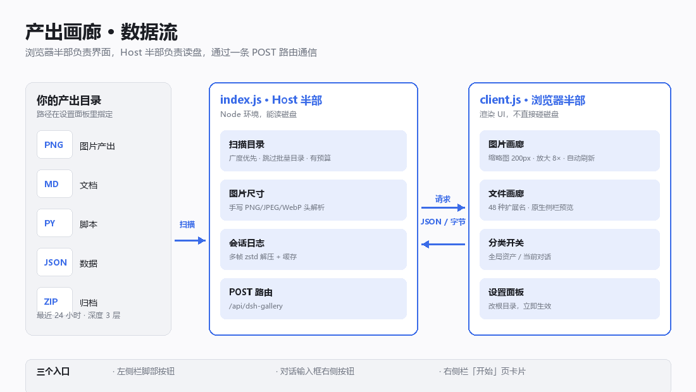

# 产出画廊 · DSH 插件

[](#)
[](LICENSE)
[](#技术说明给想改代码的人)
[](#兼容性)

在 DSH 右侧栏看**你自己的产出目录**，不是对话框里的图。

Agent 每轮跑完都把文件写到磁盘上，但 DSH 只会在任务末尾报一串路径。这个插件直接扫磁盘，把产出目录变成实时画廊：图片生成即可见，文件点一下就用 DSH 原生侧栏打开。

> **和市面上的「对话图片查看器」不一样在哪：**
>
> | | 常见的对话图片灯箱 | 这个插件 |
> |---|---|---|
> | **看哪里** | 对话里的图片附件 | **磁盘上的产出目录**（Agent 真正写文件的地方） |
> | **能看什么** | 只有图片 | 图片 + **48 种文档/代码/数据文件** |
> | **怎么打开文件** | 无 | **调 DSH 原生侧栏预览**（Markdown 渲染、代码高亮都是 DSH 自己的） |
> | **多个对话混在一起** | 不区分 | **可按「本对话产出」筛**，读会话日志判定归属 |

> **一句话安装**：解压后在该目录执行 `node install.mjs`，然后重启 DSH。
> 详细步骤见[安装](#安装)，常见问题见[已知限制](#已知限制)。

---

## 它解决什么问题

DSH 默认把产出**攒到任务末尾**才列名称和路径，中间过程看不见，没法及时校验、及时干预。

这个插件把产出目录变成一个实时画廊：

- 图片自动刷新（5 秒），生成即可见
- 文件卡片一列面全，点一下就在 DSH 原生侧栏打开
- 还能按「本对话产出」筛，一眼分清哪些是这个对话做的

**典型场景**：让 Agent 批量出 30 张图，你不用等它跑完再一张张点路径核对——侧栏里实时滚动，看到哪张不对当场就能喊停改提示词。

---

## 功能

### 图片画廊

| 能力 | 说明 |
|---|---|
| **自动刷新** | 每 5 秒轮询，查看大图时自动暂停，不打断 |
| **缩略图** | 客户端 canvas 压缩到 200px（不是原图直塞），并发闸门 4，进入视口才加载 |
| **放大查看** | 滚轮缩放（最大 8×）、超出面板后按住鼠标中键拖动 |
| **退出回位** | 单击退出，回到原来那张缩略图的**精确位置**，不是列表顶部 |

### 文件画廊

列文档 / 代码 / 数据 / 压缩包 / 链接 / 设计文件，共 48 种扩展名（**不含图片**，图片归图片画廊）。

| 操作 | 行为 |
|---|---|
| 点整张卡片 / 点「👁 预览」 | 用 DSH **原生侧栏**打开预览（Markdown 渲染、代码高亮都是 DSH 自己的） |
| 点「⧉ 复制路径」 | 复制绝对路径，按钮变 `✓ 已复制` 反馈 1.6 秒 |
| 点「📂」 | 在资源管理器里定位该文件 |

### 分类开关

```
[全局资产]  [当前对话]
```

- **全局资产**：产出目录下全部内容，按时间倒序
- **当前对话**：只显示**本对话真正产出过**的文件 —— 通过解析 DSH 会话日志得出（只认 `write` / `edit` / `present` 这类真正产生文件的调用），不是按时间瞎猜

### 产出根目录可配置

**装上不会空白。** 插件按这个顺序确定产出目录：

1. **面板内设置**（最高优先，改完**立即生效，无需重启**）
2. `cordis.patch.yml` 里显式配置的 `root`
3. **自动探测**：先找 `~/DSH产出`、`~/Documents/DSH产出`、`~/Desktop/DSH产出`、`~/Downloads/DSH产出`，再遍历各盘符找 `<盘符>:\DSH产出`（循环 A–Z，代码里不写死任何字母，所以装在哪个盘都能自动找到）

目录找不到时，面板会直接给出「修改产出根目录」按钮，点开就能改。

---

## 安装

### 前置

已安装 DSH 桌面版或 Web 版。

### 方式零：DSH 插件页一行装（最省事）

打开 DSH → **插件页** → **添加插件** → **安装第三方插件**，在输入框粘贴：

```
github:Hope2023Dcr/dsh-gallery
```

点安装。DSH 会自动从 GitHub 拉取并装好，装完重启 DSH。

> 想锁定版本（推荐，避免仓库更新导致行为变化）：
>
> ```
> git+https://github.com/Hope2023Dcr/dsh-gallery.git#03c05fb324aeca02cbf0b4bafff9542b013f212b
> ```

> ⚠️ 这种方式需要**能访问 GitHub**。DSH 的「国内镜像」只代理 npm 包，不代替 GitHub 下载。

### 方式一：一键脚本（推荐，可离线）

下载本仓库（`Code → Download ZIP`，或 `git clone`），解压后**在解压出来的目录里**执行：

```bash
node install.mjs
```

脚本会自动：

1. 定位 DSH 主目录（优先 `DSH_HOME` 环境变量，回退 `~/.dsh`）
2. 列出可用 profile 让你选（只有一个时直接用它，多个时默认 `desktop`）
3. 校验源文件齐全
4. 复制到 `<profile>/node_modules/dsh-gallery/`
5. 在 profile 的 `package.json` 的 `bundles` 里注册
6. **自动备份原 `package.json`** 为 `package.json.bak-dsh-gallery`

可选参数：

```bash
node install.mjs --profile desktop   # 指定 profile
node install.mjs --dry-run           # 只看会做什么，不写入
```

> 脚本幂等：重复运行不会重复注册 bundle。

**装完必须重启 DSH**（不是刷新页面）。

### 方式二：手动安装

**1. 找到你的 profile 目录**

| 平台 | 路径 |
|---|---|
| Windows | `%USERPROFILE%\.dsh\profiles\desktop` |
| macOS / Linux | `~/.dsh/profiles/desktop` |

> 如果 `desktop` 不存在，看你实际用的 profile 名（`profiles/` 下有什么就用什么）。

**2. 复制文件到插件目录**

目标：`<profile>/node_modules/dsh-gallery/`

需要放进去的文件：`index.js`、`client.js`、`package.json`、`cordis.patch.yml`、`icon.svg`、`locale/`。

Windows PowerShell：

```powershell
$target = "$env:USERPROFILE\.dsh\profiles\desktop\node_modules\dsh-gallery"
New-Item -ItemType Directory -Force -Path $target | Out-Null
Copy-Item index.js,client.js,package.json,cordis.patch.yml,icon.svg -Destination $target
Copy-Item locale -Destination $target -Recurse
```

macOS / Linux：

```bash
target=~/.dsh/profiles/desktop/node_modules/dsh-gallery
mkdir -p "$target"
cp index.js client.js package.json cordis.patch.yml icon.svg "$target/"
cp -r locale "$target/"
```

**3. 在 profile 的 package.json 里注册**

编辑 `<profile>/package.json`，在 `bundles` 数组里加一项：

```json
{
  "bundles": [
    "dsh-gallery"
  ]
}
```

**4. 重启 DSH**

必须**完全退出**再打开（不是刷新页面）。Host 半部只在进程启动时加载。

**5. 打开面板**

三个入口任选：

- 左侧边栏脚部的 `▦` 按钮
- 对话输入框右侧的 `▦` 按钮
- 右侧栏点 `+`，「开始」页里的「产出画廊」卡片

**6. 设置产出目录**

第一次打开如果显示「目录不存在」，点面板里的 **⚙ 设置**，填入你的产出目录绝对路径，保存即可生效。

---

## 配置项

编辑 `<插件目录>/cordis.patch.yml`：

```yaml
config:
  # root: 'D:/产出'      # 不填就走自动探测
  windowHours: 24         # 只看最近 N 小时内的产出
  maxItems: 60            # 最多显示多少条
  maxDepth: 3             # 向下扫描几层目录
  skipDirs:               # 跳过这些目录（体积大、无产出）
    - node_modules
    - .git
    - ...
```

改完重启 DSH 生效。**只想改目录的话，建议用面板里的 ⚙ 设置**，那个不用重启。

---

## 已知限制

1. **「当前对话」分类依赖 DSH 会话日志格式。** 它读 `~/.dsh/sessions/<分组>/<sessionId>/session.v4.jsonl.zstd`，解析 `tool/call` 事件。DSH 大版本升级后这个功能可能失效，需要回归验证；其余功能不受影响。
2. **只扫一层层的目录，深度默认 3 层。** 特别深的目录结构会漏。
3. **默认只看最近 24 小时。** 改 `windowHours` 可以放宽，但太大会拖慢扫描。
4. **文件画廊故意不显示图片。** 图片归图片画廊，避免两边重复。
5. **`reveal`（资源管理器定位）仅 Windows 有效。** 其他平台会走 `xdg-open` 打开所在目录。

---

## 技术说明（给想改代码的人）



### 结构

```
dsh-gallery/
├── package.json        # bundle 清单 + dsh.client（web 平台）
├── cordis.patch.yml    # 插入 Host 行与默认配置
├── index.js            # Host 半部：扫描、图片尺寸解析、会话日志解析、HTTP 路由
├── client.js           # 浏览器半部：侧栏 tab UI、缩略图、放大、设置面板
├── locale/zh.json      # 中文文案
├── locale/en.json
└── icon.svg
```

### 两端分工

| 半部 | 能做什么 | 不能做什么 |
|---|---|---|
| `index.js`（Host） | 读文件、扫目录、注册 HTTP 路由、调 `child_process` | 不能碰 DOM |
| `client.js`（浏览器） | 渲染 UI、拿 slot props、调 `ctx.sidebarRight.*` | 不能直接读磁盘 |

数据流：client `fetch(ROUTE)` POST 给 host → host 处理 → 返回 JSON / 字节。

### ⚠️ 改代码后怎么生效

| 改了哪个文件 | 生效方式 |
|---|---|
| `client.js` | **刷新页面**（秒级） |
| `index.js` | **必须重启 DSH 进程**（分钟级） |

判断「跑的是不是新代码」：**哈希一致 + 进程启动时间 < 文件修改时间 → 运行的是旧模块**，需要重启。

### 关键实现点

- **图片尺寸解析**：Host 侧直接读 PNG IHDR / JPEG SOF / WebP VP8·VP8L·VP8X 头部，零依赖
- **缩略图压缩**：客户端 `createImageBitmap` + `OffscreenCanvas`，不把原图塞进 ``
- **tab 保活**：注册 tab 类型时声明 `keepMounted: true`，切到别的 tab 再回来状态不丢
- **原生预览地址**：`dsh-resource://file/session/<sessionId>/<编码路径>`，文档预览只认 session 作用域
- **会话日志多帧 zstd**：DSH 日志每次追加写一帧，必须按魔数 `0x28 0xB5 0x2F 0xFD` 切开逐帧解压，单次解压只能拿到第一帧

---

## 许可

MIT。随便用、改、分发。
